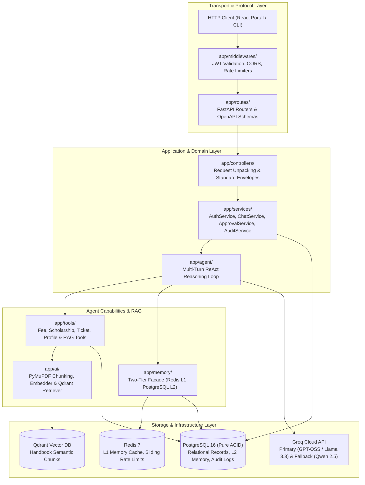
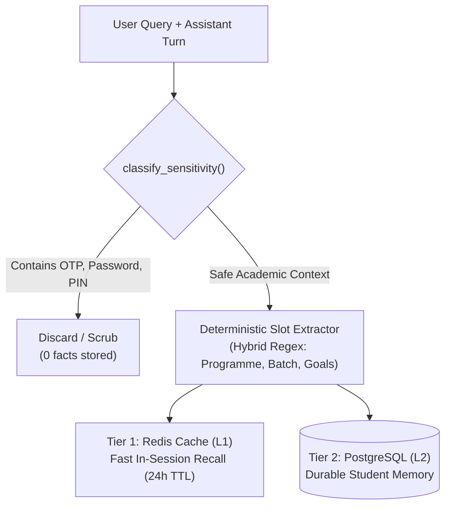

# 🏛️ Backend Core & Application Architecture Guide

> **Component**: Core Backend & Agent Service (`Intelligent_Student_Support_Agent`)  
> **Frameworks**: FastAPI 0.115+ (Python 3.12) | PostgreSQL 16 | Redis 7 | Qdrant Vector DB | Groq Cloud  
> **Master Overview**: For the monorepo overview, full-stack setup, and video demo, refer to the [Root Master README](../README.md).  

---

## ⚡ Quick Navigation

| Section | Focus Area |
|---|---|
| 🏛️ **[Backend Layered Architecture](#️-backend-layered-architecture)** | Domain-Driven Design (DDD), Clean Layering & Data Flow |
| 📁 **[Module Documentation Index](#-module-documentation-index)** | Clickable guides for all 15 backend subpackages |
| 🗄️ **[Relational Data Models](#️-relational-data-models--storage-schema)** | PostgreSQL tables, Alembic migrations, and schema design |
| 🧠 **[Dual-Tier Memory Architecture](#-dual-tier-memory-architecture)** | Ephemeral Redis cache + Durable PostgreSQL memory |
| 🛡️ **[Security, Authorization & Audit](#️-security-authorization--audit-controls)** | Code-level ownership, approval gates & immutable audit trails |
| 👥 **[Student Test Personas](#-student-test-personas--option-2-enrollment)** | Pre-seeded PostgreSQL cohorts (`STU001`–`STU020`) |
| 🌐 **[API Endpoint Reference](#-api-endpoint-reference)** | Summary of all 17 REST endpoints |
| 🧪 **[Backend Testing & Verification](#-backend-testing--verification)** | Automated test execution with Pytest & Alembic |

---

## 🏛️ Backend Layered Architecture

The backend application is organized strictly according to **Clean Architecture** and **SOLID Principles**, enforcing clear separation between transport gateways, business logic, agentic execution, and infrastructure:



### Architectural Guarantees:
1. **Zero SQLite Fallback**: The backend connects exclusively to PostgreSQL (`postgresql+asyncpg://...`). If PostgreSQL is unreachable, the system fails fast at startup with diagnostic telemetry, preventing multi-database schema drift.
2. **Single Responsibility (SRP)**: Controllers strictly unpack requests and format envelopes; business logic resides solely in `app/services/`; database access is isolated in domain models and tools.
3. **Dependency Inversion (DIP)**: Database sessions (`AsyncSession`) and LLM providers are injected via FastAPI dependencies and abstract factory patterns.

---

## 📁 Module Documentation Index

Every backend subpackage contains its own self-contained **`README.md`** detailing component tables, class diagrams, and design rationales:

| Subpackage | Documentation Guide | Primary Architectural Responsibility |
|---|---|---|
| **Controllers** | [📖 `app/controllers/README.md`](./app/controllers/README.md) | Request dispatching, caller identity extraction, and standardized JSON envelopes (`success_response`). |
| **Routes** | [📖 `app/routes/README.md`](./app/routes/README.md) | Declarative REST endpoints, Pydantic body validation, and dependency injection wiring. |
| **Services** | [📖 `app/services/README.md`](./app/services/README.md) | Core business logic, student identity lifecycle, and multi-turn agent turn orchestration. |
| **Exceptions** | [📖 `app/exceptions/README.md`](./app/exceptions/README.md) | Centralized domain exception hierarchy (`AppError`) and global HTTP error translation. |
| **Middlewares** | [📖 `app/middlewares/README.md`](./app/middlewares/README.md) | Bearer JWT token decoding, identity validation, and `get_current_student` guard. |
| **Models** | [📖 `app/models/README.md`](./app/models/README.md) | SQLAlchemy 2.0 async relational schemas, foreign keys, and PostgreSQL `JSONB` fields. |
| **Schemas** | [📖 `app/schemas/README.md`](./app/schemas/README.md) | Pydantic v2 DTOs for inbound requests, outbound payloads, and OpenAI tool schemas. |
| **Tools** | [📖 `app/tools/README.md`](./app/tools/README.md) | Domain tools dynamically invoked by the agent with ownership checks (`fee`, `scholarship`, `ticket`, `profile`, `rag`). |
| **Memory** | [📖 `app/memory/README.md`](./app/memory/README.md) | Two-tier state facade: Redis sliding cache + PostgreSQL durable facts with privacy scrubbing. |
| **Agent** | [📖 `app/agent/README.md`](./app/agent/README.md) | Multi-turn ReAct reasoning loop, Groq LLM client provider, and token/latency tracing. |
| **Providers** | [📖 `app/providers/README.md`](./app/providers/README.md) | Multi-provider LLM factory, dynamic fallback (`qwen/qwen3.8-27b`), and wire clients. |
| **AI & RAG** | [📖 `app/ai/README.md`](./app/ai/README.md) | PDF extraction, dynamic semantic chunking, local embeddings, and Qdrant vector search. |
| **Prompts** | [📖 `app/prompts/README.md`](./app/prompts/README.md) | Dynamic system prompt builder, persona directives, citation rules, and memory injection. |
| **Config** | [📖 `app/config/README.md`](./app/config/README.md) | Environment configuration (`BaseSettings`), PostgreSQL connection pool, and Redis client. |
| **Utils** | [📖 `app/utils/README.md`](./app/utils/README.md) | Ownership security guardrails, bcrypt password hashing, and Loguru logging. |

---

## 🗄️ Relational Data Models & Storage Schema

The PostgreSQL database maintains 8 core domain tables orchestrated via SQLAlchemy 2.0 Async and tracked through Alembic migrations (`alembic/`):

| Table Name | Model Class | Primary Key | Description & Key Invariants |
|---|---|:---:|---|
| **`students`** | `Student` | `id` (UUID) | Official institutional roster (`student_id`, `name`, `programme`, `batch`, `phone`, `email`, `address`, `status`). |
| **`auth_credentials`** | `AuthCredentials` | `id` (UUID) | Password hashes (`bcrypt`), active status, and unique 1:1 foreign key to `students.student_id`. |
| **`fee_records`** | `FeeRecord` | `id` (UUID) | Tuition ledger records (`total_fee`, `paid`, `pending`, `due_date`, `status`, `receipt`). |
| **`scholarships`** | `Scholarship` | `id` (UUID) | Active aid grants, concession percentages, and semester grant allocations. |
| **`support_tickets`** | `SupportTicket` | `id` (UUID) | Administrative escalation tickets (`ticket_id`, `category`, `priority`, `status`, `description`). |
| **`student_memory`** | `StudentMemory` | `id` (UUID) | Permanent L2 facts (`student_id`, `fact_key`, `fact_value`, `confidence`). |
| **`audit_logs`** | `AuditLog` | `id` (UUID) | Immutable compliance log (`student_id`, `action`, `target_id`, `decision`, `result`). |
| **`conversations`** | `Conversation` | `id` (UUID) | Chat sessions with cascading foreign key to `messages`. |
| **`messages`** | `Message` | `id` (UUID) | Turn-by-turn chat messages (`role`, `content`, `meta_data` JSONB). |

---

## 🧠 Dual-Tier Memory Architecture

The memory subsystem is managed by `MemoryManager` (`app/memory/memory_manager.py`) and operates across two tiers:



* **Tier 1 (Redis Cache)**: Keyed as `student_memory:{student_id}` with a 24-hour sliding TTL for instant retrieval during active sessions.
* **Tier 2 (PostgreSQL)**: Durable table `student_memory` ensuring facts persist permanently across browser restarts and device changes.
* **Zero Token Extraction**: Uses deterministic Python regex slot patterns (`programme`, `batch`, `preferred_name`, `academic_goal`), consuming **0 LLM tokens** for memory persistence.

---

## 🛡️ Security, Authorization & Audit Controls

### 1. Deterministic Identity Binding (JWT)
Requests to `/api/v1/chat`, `/api/v1/student/*`, and `/api/v1/audit/*` require an `Authorization: Bearer <token>` header. The token subject (`sub`) is extracted via FastAPI's `get_current_student` dependency and passed directly into the service layer.

### 2. Code-Level Ownership Gate ([`ownership.py`](./app/utils/ownership.py))
Authorization is never delegated to the LLM. In `get_fee_status`, `check_scholarship`, and `get_ticket_status`:
```python
check_ownership(requesting_student_id=caller_id, target_student_id=target_id)
```
If `caller_id != target_id`, the function raises `PermissionDeniedError`, records a `BLOCKED` decision in `audit_logs`, and immediately returns an access denied response.

### 3. Human-in-the-Loop Approval Gate ([`approval_service.py`](./app/services/approval_service.py))
Actions modifying student directory records or requesting fee waivers pause execution:
- **Turn 1**: The agent generates an `ApprovalRequest(status="PENDING")` and prompts the student for confirmation.
- **Turn 2**: A student affirmative reply (`YES`, `CONFIRM`) transitions status to `APPROVED`, executing the mutation. Any refusal transitions to `REJECTED`, leaving the database completely untouched.

### 4. Immutable Audit Trail ([`audit_service.py`](./app/services/audit_service.py))
Every security-sensitive decision is written synchronously to PostgreSQL:
```sql
INSERT INTO audit_logs (student_id, action, target_id, decision, result, created_at) ...
```

---

## 👥 Student Test Personas & Option 2 Enrollment

The database is seeded with **20 comprehensive student accounts** via `just seed`:

* **Pre-Activated Accounts (`STU001`–`STU005`)**: Initialized with default password `Student@123` for immediate login and verification.
* **Self-Enrollment Cohort (`STU006`–`STU020`)**: Admitted in university records but unactivated. Used to verify the Option 2 self-enrollment workflow via `POST /api/v1/auth/signup`.
* **Negative Test Persona (`STU999`)**: Not present in university records. Registration returns `404 Not Found`.

| Student ID | Student Name | Programme | Fee Status | Scholarship Status | Account State | Testing Scenario |
|:---:|---|---|---|---|:---:|---|
| **`STU001`** | **Rahul Sharma** | PGDM AI & DS | Partially Paid (₹225k due) | 20% Merit Award | Pre-Activated (`Student@123`) | Fee check, scholarship inquiry, cross-student rejection. |
| **`STU002`** | **Priya Patel** | MBA Marketing | Paid in Full (₹0 due) | None | Pre-Activated (`Student@123`) | Zero-balance verification, cross-tenant isolation target. |
| **`STU003`** | **Amit Verma** | B.Tech CSE | Overdue (₹200k balance) | 15% Sports Grant | Pre-Activated (`Student@123`) | Overdue fee notification and disciplinary policy search. |
| **`STU004`** | **Sneha Gupta** | M.Tech Data Science | Unpaid (₹380k due) | 25% Research Fellowship | Pre-Activated (`Student@123`) | Ticket creation and multi-turn memory recall across turns. |
| **`STU005`** | **Vikram Malhotra** | BBA Analytics | Partially Paid (₹150k due) | None | Pre-Activated (`Student@123`) | Administrative inquiries and profile contact updates. |
| **`STU006`** | **Ananya Iyer** | B.Tech AI & ML | Partially Paid (₹210k due) | 30% Women in Tech | Available for `/signup` | Option 2 self-registration verification. |
| **`STU007`–`STU020`** | *Enrolled Roster* | Diverse UG / PG | Mixed Dues | Mixed Aid Grants | Available for `/signup` | Extended cohort registration testing. |

---

## 🌐 API Endpoint Reference

The backend provides 17 RESTful endpoints. Detailed request/response schemas, OWASP headers, and cURL commands are documented in **[📖 API Documentation (`API_DOCUMENTATION.md`)](./API_DOCUMENTATION.md)**:

* **Authentication & Credentials** (`/api/v1/auth`):
  * `POST /signup` — Register credentials for an enrolled student (Option 2).
  * `POST /login` — Authenticate and receive a Bearer JWT.
  * `POST /change-password` — Update password for the authenticated caller.
  * `GET /me` — Retrieve the current authenticated student profile.
* **Conversational Agent** (`/api/v1/chat`):
  * `POST /` — Multi-turn reasoning turn with tools, RAG, and memory.
  * `GET /conversations` — List conversation sessions owned by the caller.
  * `GET /conversations/{id}/messages` — Message history and trace metadata.
  * `DELETE /conversations/{id}` — Delete a conversation and associated turns.
* **Student Records** (`/api/v1/student`):
  * `GET /profile` / `PUT /profile` — Read or update contact details.
  * `GET /fees` — Read tuition ledger and payment receipts.
  * `GET /scholarship` — Read active aid grant details.
  * `GET /tickets` — List support tickets filed by the student.
* **Audit & Compliance** (`/api/v1/audit`):
  * `GET /logs` — Filterable audit trail stream.
  * `GET /summary` — Aggregate safety and authorization metrics.
* **Handbook Ingestion & System Health**:
  * `POST /api/v1/ingest` — Parse and vectorize handbook PDF.
  * `GET /health` — Non-blocking health probe (PostgreSQL, Redis, Qdrant).

---

## 🧪 Backend Testing & Verification

The backend includes comprehensive automated test suites covering unit logic, database integrity, and security invariants:

```bash
# Run Task 9 test suite (Authentication, Memory, Security, and Audit)
uv run pytest tests/test_task9.py

# Run tool-specific test suite
uv run pytest tests/test_password_and_ticket_tools.py

# Run database migration check
uv run alembic check
```

For evaluation benchmark reports and comparison tables, see:
* [📄 Final Evaluation Report (Assignment 1 vs. 2)](./evaluation/results/final_evaluation_report.md)
* [📄 Privacy & Approval Rules Architecture](./evaluation/results/privacy_approval_explanation.md)
* [📄 Chunking Fidelity Audit](./evaluation/results/chunking_audit_report.md)
* [📄 Identity Auth & Access Control Audit](./evaluation/results/auth_audit_report.md)
