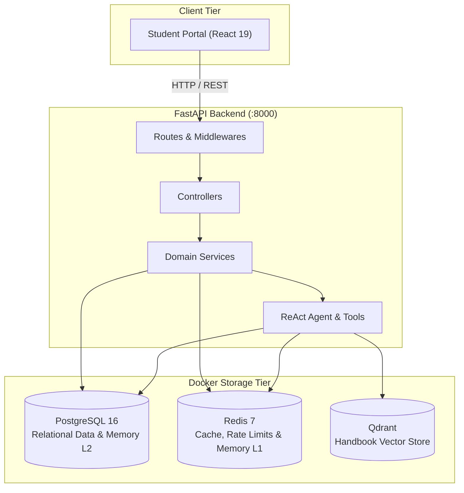
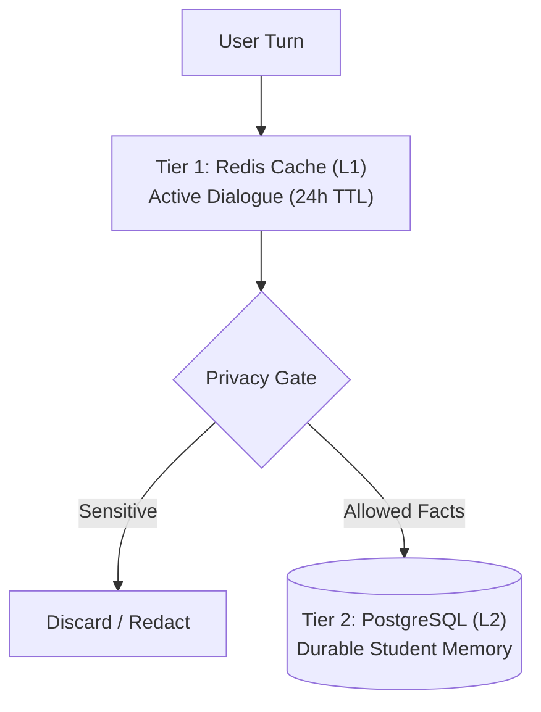

# 🎓 Intelligent Student Support Agent

> **Production-Grade Multi-Turn Conversational AI for University Academic & Administrative Support**  
> *Built with FastAPI, Pure PostgreSQL (Docker), Redis Sliding Cache, Qdrant Vector Search, and Groq-powered Function Calling.*

---

## ⚡ Quick Navigation

| Section | Focus Area |
|---|---|
| 🏛️ **[System Architecture](#️-system-architecture)** | Multi-tier design, clean layering, and data flows |
| 📡 **[Full API Documentation](./API_DOCUMENTATION.md)** | Complete RESTful contracts, schemas, headers, & curl commands |
| 📁 **[Module Documentation Index](#-module-documentation-index)** | Clickable guides for all 15 backend subpackages |
| 👥 **[Student Personas & Option 2](#-student-personas--option-2-enrollment)** | Pre-seeded PostgreSQL records (`STU001`–`STU020`) |
| 🧠 **[Dual-Tier Memory Mechanics](#-dual-tier-memory-mechanics)** | Ephemeral Redis cache + Durable PostgreSQL memory |
| 🛡️ **[Security & Guardrails](#️-enterprise-security--guardrail-architecture)** | JWT authentication, ownership controls & audit trails |
| 🌐 **[API Contracts & Verification](#-api-endpoint-contracts--live-verification)** | Detailed REST specs & live integration test matrix |
| 📊 **[Evaluation & Benchmarks](#-benchmark-evaluation-results)** | Ingestion fidelity & 8-scenario benchmark results |
| 🚀 **[Developer Automation (`Justfile`)](#-developer-automation-justfile)** | Routine commands for backend, frontend, and Docker |

---

## 🏛️ System Architecture

The application is structured following **Domain-Driven Design (DDD)** and **SOLID Principles**:



> [!NOTE]
> **Zero SQLite Fallback Policy**: The system connects exclusively to PostgreSQL (`postgresql+asyncpg://...`). If PostgreSQL is unreachable, the application fails fast with diagnostic startup messages, eliminating dual-database drift.

---

## 🛠️ Technology Stack & System Components

| Layer / Domain | Technology / Tool | Version / Model | Architectural Responsibility |
|---|---|---|---|
| **Frontend Portal** | React + Vite | React 19, Vite 5 | SPA student interface, interactive chat, dashboard tabs |
| **Frontend Styling** | Tailwind CSS + Lucide | Tailwind 3, Lucide React | Modern responsive design system, reactive card layouts |
| **API Gateway** | FastAPI + Uvicorn | FastAPI 0.115+, Uvicorn 0.28+ | High-throughput async REST endpoints, Pydantic v2 validation |
| **Security & Identity** | PyJWT / Passlib / SlowAPI | HS256, bcrypt | Stateless JWT bearer tokens, sliding-window rate limiter |
| **Agent Core** | ReAct Reasoning Loop | Native Python 3.12 | Autonomous multi-turn tool calling, ownership gatekeeper |
| **Primary LLM** | Groq Cloud API | `openai/gpt-oss-120b` / `llama-3.3-70b` | High-speed multi-turn instruction & reasoning (<1s TTFT) |
| **Fallback LLM** | Groq Cloud API | `qwen/qwen3.8-27b` | Dynamic failover provider on primary timeout or quota limits |
| **Vector Store** | Qdrant Vector DB | Qdrant 1.8+ (Docker) | Cosine similarity vector search over 44-page handbook |
| **Local Embedder** | SentenceTransformers | `Orange/orange-nomic-v1.5-1536` | 1536-dim embeddings with singleton cache (<0.01ms LRU) |
| **Re-Ranker** | Cross-Encoder | `cross-encoder/ms-marco-MiniLM-L-6-v2` | Two-stage deep semantic re-ranking on CPU with LRU cache |
| **Relational Database** | PostgreSQL | PostgreSQL 16 (Docker) | Pure ACID store for students, fees, tickets, audit logs, memory L2 |
| **Cache & State Store** | Redis | Redis 7 (Docker) | 24h sliding conversation memory (L1), rate limiters, RAG cache |
| **Document Ingestion** | PyMuPDF (fitz) | PyMuPDF 1.23+ | Semantic chunking, heading detection, and page provenance |
| **DevOps & Tasks** | Justfile / Docker | Docker Compose 3.8+ | One-command orchestration (`just up`, `just server`, `just frontend`) |

---


## 📁 Module Documentation Index

Every backend subpackage contains a dedicated **`README.md`** detailing its responsibilities, architectural diagrams, component tables, and SOLID principles:

| Subpackage | Documentation Guide | Primary Architectural Responsibility |
|---|---|---|
| **Controllers** | [📖 `app/controllers/README.md`](./app/controllers/README.md) | Request dispatching, caller unpacking, and standard JSON envelopes (`success_response`). |
| **Routes** | [📖 `app/routes/README.md`](./app/routes/README.md) | RESTful API paths, Pydantic body validation, and FastAPI dependency wiring. |
| **Services** | [📖 `app/services/README.md`](./app/services/README.md) | Core business logic, identity lifecycles, and agent turn orchestration. |
| **Exceptions** | [📖 `app/exceptions/README.md`](./app/exceptions/README.md) | Domain exception hierarchy (`AppError`) and global HTTP error translation. |
| **Middlewares** | [📖 `app/middlewares/README.md`](./app/middlewares/README.md) | Bearer JWT token decoding, identity validation, and `get_current_student` guard. |
| **Models** | [📖 `app/models/README.md`](./app/models/README.md) | SQLAlchemy 2.0 async relational schemas, foreign keys, and PostgreSQL `JSONB` fields. |
| **Schemas** | [📖 `app/schemas/README.md`](./app/schemas/README.md) | Pydantic v2 DTOs for inbound requests, outbound payloads, and OpenAI tool schemas. |
| **Tools** | [📖 `app/tools/README.md`](./app/tools/README.md) | Real database and RAG tools invoked dynamically by the agent during multi-turn chat. |
| **Memory** | [📖 `app/memory/README.md`](./app/memory/README.md) | Two-tier state: Redis 24h sliding window + PostgreSQL durable facts with privacy scrubbing. |
| **Agent** | [📖 `app/agent/README.md`](./app/agent/README.md) | Multi-turn agent loop, Groq LLM client provider, and token/latency tracing. |
| **Providers** | [📖 `app/providers/README.md`](./app/providers/README.md) | Multi-provider LLM factory, dynamic fallback (`qwen/qwen3.8-27b`), and wire clients. |
| **AI & RAG** | [📖 `app/ai/README.md`](./app/ai/README.md) | PDF extraction, dynamic semantic chunking, local embeddings, and Qdrant vector search. |
| **Prompts** | [📖 `app/prompts/README.md`](./app/prompts/README.md) | Dynamic system prompt builder, persona directives, citation rules, and memory injection. |
| **Config** | [📖 `app/config/README.md`](./app/config/README.md) | Environment configuration (`BaseSettings`), PostgreSQL engine, and Redis client. |
| **Utils** | [📖 `app/utils/README.md`](./app/utils/README.md) | Ownership security guardrails, bcrypt password hashing, and Loguru logging. |

---

## 👥 Student Personas & Option 2 Enrollment

The database is pre-seeded with **20 comprehensive student records** (`STU001` through `STU020`) via `just seed`:

* **Pre-Activated Demo Accounts (`STU001`–`STU005`)**: Initialized with default password `Student@123` for instant portal login and testing.
* **Available Registration Cohort (`STU006`–`STU020`)**: Enrolled in university records but awaiting account creation. Users register them via `/signup`.

| Student ID | Name | Programme | Fee Status | Scholarship | Account State | Recommended Test Query / Scenario |
|:---:|---|---|---|---|:---:|---|
| **`STU001`** | **Rahul Sharma** | PGDM AI & DS | Partially Paid (₹225k due Oct 31) | 20% Merit (Active) | Pre-Activated | *"What is my remaining fee balance and my scholarship details?"* |
| **`STU002`** | **Priya Patel** | MBA Marketing | Paid in Full (₹0 due, RCP-0810) | None | Pre-Activated | *"Check if I have any pending fee dues."* |
| **`STU003`** | **Amit Verma** | B.Tech CSE | **Overdue** (₹200k since Sept 1) | 15% Sports (Active) | Pre-Activated | *"What happens if my fees are overdue and how much do I owe?"* |
| **`STU004`** | **Sneha Gupta** | M.Tech Data Science | Unpaid (₹380k due Nov 15) | 25% Research (Active) | Pre-Activated | *"Can I raise a ticket regarding fee installment extensions?"* |
| **`STU005`** | **Vikram Singh** | BBA | Paid in Full (₹0 due, RCP-0720) | None | Pre-Activated | *"What are the library timings and borrowing rules?"* |
| **`STU006`** | **Ananya Iyer** | B.Tech AI & ML | Partially Paid (₹210k due Nov 30) | 30% Women in Tech | Available | Register via `/signup` with password `Password@123`. |
| **`STU007`–`STU020`**| *Enrolled Cohort* | Diverse UG / PG | Mixed (Paid, Overdue, Pending) | Merit & Need-based | Available | Self-registration testing across degree programmes. |

> [!IMPORTANT]
> **Option 2 Enrollment Gatekeeper**: Attempting to register an unknown ID (e.g., `STU999`) returns `HTTP 404 Not Found`:  
> *"Student ID 'STU999' is not enrolled in the university records. Registration requires an enrolled Student ID (STU001 through STU020)."*

---

## 🧠 Dual-Tier Memory Mechanics

The agent implements a privacy-first, dual-tier memory system:



---

## 🛡️ Enterprise Security & Guardrail Architecture

1. **Authentication**: Passwords hashed using bcrypt. Stateless JWT verification via FastAPI `get_current_student` dependency.
2. **Code-Level Ownership Enforcement**: Enforced directly inside tool functions (`app/utils/ownership.py`). Authenticated caller `STU001` cannot read or query records belonging to `STU002`.
3. **Approval Gate for Sensitive Actions**: Human-in-the-loop confirmation required before modifying student records or submitting grievance/appeal tickets.
4. **Immutable Audit Trails**: Every tool execution and access decision (`ALLOWED`, `BLOCKED`, `APPROVED`, `REJECTED`) is recorded synchronously in PostgreSQL table `audit_logs`.

---

## 🌐 API Endpoint Contracts & Live Verification

### 1. Route Contracts Summary (All 17 Endpoints)

*For exhaustive payload schemas, cURL commands, OWASP headers, and error code envelopes, see **[📖 Full API Documentation (`API_DOCUMENTATION.md`)](./API_DOCUMENTATION.md)** and **[🛣️ Routes Module Specification (`app/routes/README.md`)](./app/routes/README.md)**.*

* **Authentication & Identity** (`/api/v1/auth`):
  * `POST /signup` — Enrolls existing student from university roster (`Option 2`).
  * `POST /login` — Authenticates credentials and issues signed Bearer JWT (`20 req/min rate limit`).
  * `POST /change-password` — Immediately updates password for authenticated student (`Bearer JWT`).
  * `GET /me` — Verifies token validity and returns authenticated student profile (`Bearer JWT`).
* **Multi-Turn AI Agent Chat** (`/api/v1/chat`, Protected via Bearer JWT):
  * `POST /` — Multi-turn ReAct agent reasoning turn with dynamic Groq fallback (`qwen/qwen3.8-27b`) and sub-second RAG retrieval (`30 req/min rate limit`).
  * `GET /conversations` — Lists past and active chat sessions owned by the authenticated student.
  * `GET /conversations/{id}/messages` — Chronological message turns, roles, and execution metadata for a session.
  * `DELETE /conversations/{id}` — Permanently deletes a chat session and cascading message turns.
* **Student Academic Records** (`/api/v1/student`, Protected via Bearer JWT, Tenant-Isolated):
  * `GET /profile` — Authenticated profile (programme, batch, status, contact info).
  * `PUT /profile` — Updates phone, email, and campus address directly in PostgreSQL.
  * `GET /fees` — Tuition fee ledger breakdown (total, paid, pending, due date, receipt).
  * `GET /scholarship` — Active scholarship award, percentage, and semester grant amount.
  * `GET /tickets` — Support and grievance tickets filed by the authenticated student.
* **Security Audit & Compliance** (`/api/v1/audit`):
  * `GET /logs` — Immutable security audit trail stream with filtering by decision (`ALLOWED`, `BLOCKED`, `APPROVED`, `REJECTED`).
  * `GET /summary` — Aggregated compliance metrics for Assignment 2 verification.
* **Policy Document Ingestion** (`/api/v1/ingest`):
  * `POST /` — Multipart PDF handbook upload, semantic chunking, and Qdrant vectorization.
* **Health & Diagnostics**:
  * `GET /health` — Deep non-blocking async probe across PostgreSQL (`SELECT 1`), Redis (`ping`), and Qdrant (`get_collections`).

---

### 📊 Live API Verification Matrix (PostgreSQL Backend)

The table below summarizes live integration test results executed against the running backend with Docker PostgreSQL:

| Endpoint & Method | Test Scenario | HTTP Status | Response Summary | Architectural Invariant Verified |
|:---|:---|:---:|:---|:---|
| `POST /api/v1/auth/signup` | Unregistered ID `STU999` | **404 Not Found** | `"Student ID 'STU999' is not enrolled in the university records. Registration requires an enrolled Student ID (STU001 through STU020)."` | **Option 2 Gatekeeper**: Unadmitted users are blocked from creating accounts. |
| `POST /api/v1/auth/signup` | Enrolled ID `STU006` | **201 Created** | `"Student account registered successfully."` | **Credential Creation**: Hashes password with bcrypt and records in PostgreSQL `auth_credentials`. |
| `POST /api/v1/auth/signup` | Duplicate `STU006` | **409 Conflict** | `"An account for student ID 'STU006' already exists. Please log in."` | **Collision Guard**: Idempotently prevents account overwrites. |
| `POST /api/v1/auth/login` | Login with `STU006` | **200 OK** | Returned valid signed Bearer JWT token | **JWT Lifecycle**: Issues signed token with claim `sub: STU006`. |
| `GET /api/v1/student/profile` | Bearer Token for `STU006` | **200 OK** | Loaded: Ananya Iyer, B.Tech AI & ML, Batch 2024-28 | **Referential Integrity**: Links JWT subject to PostgreSQL `students` table. |
| `GET /api/v1/student/fees` | Bearer Token for `STU006` | **200 OK** | Loaded: Total ₹4,20,000, Partially Paid, RCP-2026-0412 | **Ledger Isolation**: Resolves pre-seeded fee ledger for student. |
| `GET /api/v1/student/scholarship` | Bearer Token for `STU006` | **200 OK** | Loaded: Women in Tech Award (30% / ₹63,000) | **Aid Grant Resolution**: Fetches active award from PostgreSQL `scholarships`. |
| `GET /api/v1/student/tickets` | Bearer Token for `STU006` | **200 OK** | Retrieved 0 support tickets (clean initial state) | **Tenant Boundary**: Returns only tickets belonging to authenticated student. |

> Detailed audit logs and metrics are documented in [evaluation/results/auth_audit_report.md](file:///d:/Agentic_AI_End_Term_Project/Intelligent_Student_Support_Agent/evaluation/results/auth_audit_report.md).

---

## 📊 Benchmark Evaluation Results

The test suite evaluates 8 benchmark scenarios covering tool selection, policy RAG, persistent memory recall, privacy scrubbing, ownership blocking, and domain guardrails (`just eval`):

| ID | Scenario Description | Student | Expected Tool | Precision | Status |
|:---:|:---|:---:|:---|:---:|:---:|
| 1 | Fee status check | `STU001` | `get_fee_status` | ✅ YES | **PASS** |
| 2 | Payment policy from handbook | `STU001` | `search_student_handbook` | ✅ YES | **PASS** |
| 3 | Scholarship inquiry | `STU001` | `check_scholarship` | ✅ YES | **PASS** |
| 4 | Support ticket creation | `STU001` | `create_support_ticket` | ✅ YES | **PASS** |
| 5 | Cross-student access rejection (Security) | `STU001` | `get_fee_status` | ✅ YES | **PASS** |
| 6 | Persistent memory recall across turns | `STU004` | `None (Direct LLM)` | ✅ YES | **PASS** |
| 7 | Sensitive credentials scrubbing (Privacy) | `STU001` | `None (Direct LLM)` | ✅ YES | **PASS** |
| 8 | Out of scope domain refusal | `STU001` | `None (Direct LLM)` | ✅ YES | **PASS** |

**Benchmark Summary**: **8 / 8 Scenarios Passed (100.0%)**

---

## ⚙️ Environment Variables Reference

| Variable Name | Default Value | Description |
|---|---|---|
| `APP_ENV` | `development` | Runtime environment (`development`, `production`, `testing`) |
| `DATABASE_URL` | `postgresql+asyncpg://...` | Asynchronous PostgreSQL 16 connection string |
| `REDIS_URL` | `redis://localhost:6379/0` | Asynchronous Redis 7 connection string |
| `QDRANT_URL` | `http://localhost:6333` | Host URL for Qdrant vector database container |
| `EMBEDDING_MODEL` | `Orange/orange-nomic-v1.5-1536` | Local HuggingFace sentence transformer model |
| `EMBEDDING_DIMENSIONS` | `1536` | Embedding vector size matching Qdrant collection |
| `CHUNK_TARGET_CHARS` | `1800` | Dynamic target chunk size in characters (~450 tokens) |
| `CHUNK_OVERLAP_CHARS` | `200` | Boundary overlap between adjacent semantic chunks |
| `GROQ_API_KEY` | *(Secret)* | Groq API Key for model inference |
| `GROQ_MODEL` | `openai/gpt-oss-120b` | Primary LLM model for the agent loop |

---

## 🚀 Developer Automation (`Justfile`)

All routine operations can be executed from the **workspace root** without manual `cd` commands:

```bash
# Infrastructure Management
just up               # Start PostgreSQL, Redis, and Qdrant in Docker
just down             # Stop and remove Docker containers
just logs             # Stream container logs

# Database & Ingestion Setup
just db-init          # Run schema migrations in PostgreSQL
just seed             # Seed 20 student profiles into PostgreSQL
just ingest           # Parse, chunk, embed, and index student handbook

# Application Runtimes
just backend          # Start FastAPI backend server (http://localhost:8000)
just frontend         # Start React student portal (http://localhost:3000)
just streamlit        # Launch Streamlit development & testing UI
just cli              # Launch interactive terminal agent CLI

# Frontend Tooling
just frontend-install # Install frontend npm dependencies
just frontend-build   # Build production frontend bundle
just frontend-preview # Preview production build locally

# Benchmarks & Verification
just eval             # Execute 8 benchmark evaluation scenarios
just audit-chunks     # Audit 5-dimension chunking fidelity
just clean            # Remove temporary log files and caches
```
