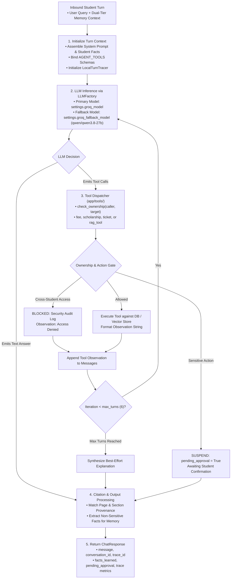

# 🤖 Agent Loop & LLM Client (`app/agent`)

The **Agent Layer** manages the execution cycle of the AI Student Support Agent, LLM inference dispatch via Groq, iterative function-calling resolution, and real-time execution trace assembly.

---

## 🏗️ Multi-Turn Agent Loop Lifecycle

---

## 📁 Module Inventory

| File | Core Component | Role & Functionality |
|---|---|---|
| [`agent_loop.py`](./agent_loop.py) | `run_agent_turn` | Executes the iterative ReAct-style loop: manages message history, calls the LLM via `LLMFactory` with dynamic fallback (`qwen/qwen3.8-27b`), executes requested database/RAG tools, and enforces loop termination. |
| [`client.py`](./client.py) | `get_async_groq_client`, `get_groq_client` | Delegates client provisioning to `app/providers/llm/factory.py` and `GroqProvider`, exposing fallback-enabled `AsyncOpenAI` instances pointed to the Groq API endpoint. |

---

## 💎 Robustness & Termination Guards

1. **Max Turn Cap**: The agent loop is hard-bounded (default: 5 iterations) to prevent infinite looping or runaway API costs.
2. **Graceful Fallback**: If an individual tool encounters a database exception, the error string is formatted as an observation rather than crashing the turn, allowing the LLM to explain the issue clearly to the student.
3. **Observability Tracking**: Records model latency, token usage (input/output/total), tool arguments, and execution durations in structured turn traces.
