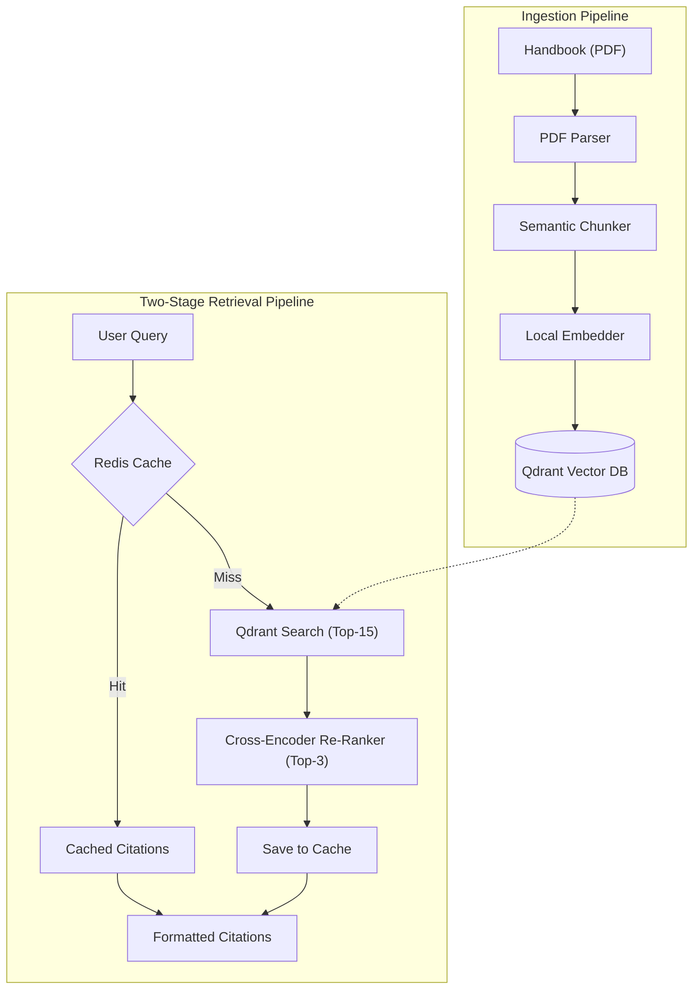

# 🧠 AI, Vector RAG & Document Ingestion (`app/ai`)

The **AI Layer** implements the end-to-end Retrieval-Augmented Generation (RAG) pipeline for university handbooks and institutional policy documents. It handles PDF document parsing, structure-preserving chunking, local dense vector embedding, Qdrant vector database search, and high-precision Cross-Encoder re-ranking.

---

## 🏗️ End-to-End Two-Stage RAG Ingestion & Retrieval Pipeline

---

## 📁 Subpackage Inventory

### A. Ingestion Subsystem (`app/ai/ingestion`)
| File | Component | Description |
|---|---|---|
| [`pdf_parser.py`](./ingestion/pdf_parser.py) | `PDFParser` | Extracts raw text, detects headings (e.g., *Annexures*, *Policy Clauses*), and maps page provenance. |
| [`chunker.py`](./ingestion/chunker.py) | `SemanticChunker` | Splits extracted text into coherent semantic windows with clause preservation and boundary overlap. |
| [`embedder.py`](./ingestion/embedder.py) | `LocalEmbedder` | Generates 1536-dimensional dense vector embeddings using local sentence transformers with thread-safe singleton caching, LRU query caching (<0.01ms), and `torch.inference_mode()`. |

### B. Retrieval Subsystem (`app/ai/retrieval`)
| File | Component | Description |
|---|---|---|
| [`vector_store.py`](./retrieval/vector_store.py) | `QdrantVectorStore` | Manages collection creation, payload indexing, dense vector search, and similarity scoring against Qdrant. |
| [`reranker.py`](./retrieval/reranker.py) | `CrossEncoderReranker` | Performs deep joint scoring between query and retrieved chunks using `cross-encoder/ms-marco-MiniLM-L-6-v2`, with LRU score caching and graceful bi-encoder fallback. |

---

## 📊 Chunking & Ingestion Fidelity Benchmark

The ingestion pipeline is audited across 5 dimensions using `just audit-chunks`:
- **Text Coverage**: **100.0%** (all tokens preserved)
- **Metadata Accuracy**: **100.0%** (accurate page number provenance)
- **Boundary Quality**: **95.31%** (clauses remain unbroken across splits)
- **Text Integrity**: **100.0%** (zero unicode artifacts or malformed ligatures)
- **Table Integrity**: **100.0%** (key-value relationships retained)
