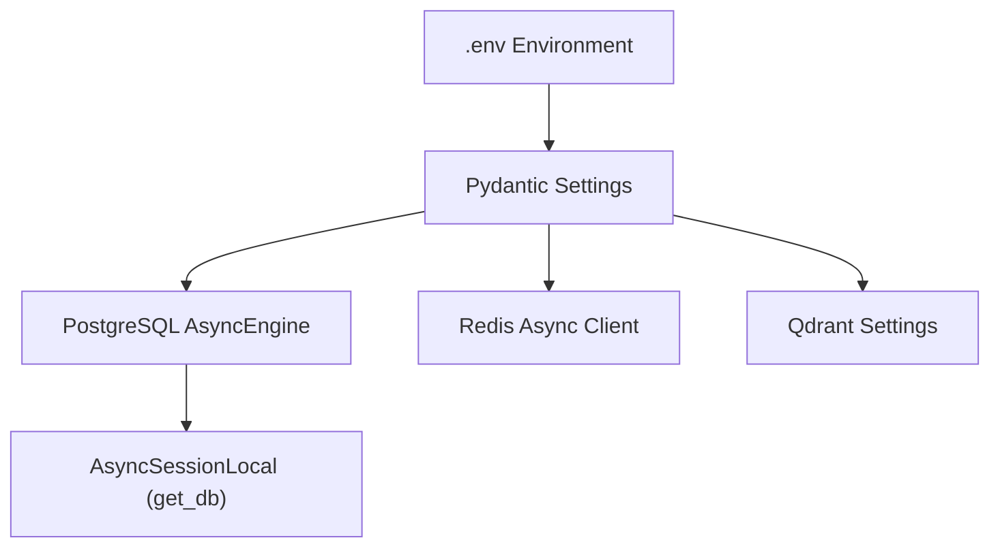

# ⚙️ Configuration & Infrastructure (`app/config`)

The **Config Layer** manages application environment variables, asynchronous database connection pooling, Redis caching singletons, and domain constant enumerations.

---

## 🏗️ Configuration & Connection Architecture

---

## 📁 Module Inventory

| File | Core Component | Role & Functionality |
|---|---|---|
| [`settings.py`](./settings.py) | `Settings`, `settings` | Pydantic v2 settings class reading from `.env` (database URLs, JWT secrets, Groq API key, Qdrant host, embedding models). |
| [`database.py`](./database.py) | `engine`, `AsyncSessionLocal`, `get_db`, `init_db` | Asynchronous SQLAlchemy 2.0 PostgreSQL engine and session factory. Enforces pure PostgreSQL with zero SQLite fallback. |
| [`redis.py`](./redis.py) | `redis_client`, `ping_redis` | Async Redis client singleton for ephemeral conversation caching and health verification. |
| [`constants.py`](./constants.py) | Enumerations | Centralized enums: `FeeStatus`, `ScholarshipStatus`, `TicketPriority`, `TicketStatus`, `DocumentStatus`, `AppEnvironment`. |

---

## 💎 Zero-SQLite Architectural Invariant

- `app/config/database.py` binds exclusively to PostgreSQL (`settings.database_url`).
- If PostgreSQL is unreachable upon startup, `check_and_initialize_database()` immediately raises a `RuntimeError` with diagnostic instructions to start Docker containers (`just up`), eliminating silent fallback and database drift.
