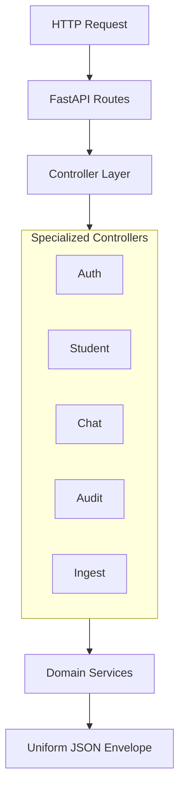

# 🎮 Controllers Layer (`app/controllers`)

The **Controllers Layer** serves as the mediation and dispatch boundary between incoming HTTP requests and internal domain services. Following the **Single Responsibility Principle (SRP)**, controllers do not perform direct database queries or heavy business logic—instead, they validate caller context, orchestrate service calls, and shape uniform JSON API responses.

---

## 🏗️ Architectural Request Flow



---

## 📁 Module Inventory

| File | Primary Controller Class | Core Responsibilities |
|---|---|---|
| [`auth_controller.py`](./auth_controller.py) | `AuthController` | Handles student registration (`signup`), password authentication (`login`), and JWT credential dispatch. |
| [`student_controller.py`](./student_controller.py) | `StudentController` | Exposes authenticated student records: personal profile, tuition fee ledgers, scholarship awards, support tickets, and contact updates. |
| [`chat_controller.py`](./chat_controller.py) | `ChatController` | Orchestrates multi-turn AI interactions, conversation session retrieval, and turn-by-turn chat history extraction. |
| [`ingestion_controller.py`](./ingestion_controller.py) | `IngestionController` | Handles handbook document upload workflows, vector ingestion trigger, and indexing status checks. |
| [`audit_controller.py`](./audit_controller.py) | `AuditController` | Queries immutable compliance audit logs, security event streams, and access decision summaries (`ALLOWED`, `BLOCKED`, `APPROVED`). |

---

## 💎 Design Patterns & SOLID Principles

- **Single Responsibility (SRP)**: Controllers focus strictly on HTTP coordination and response envelopes (`success_response`, `error_response`).
- **Dependency Inversion (DIP)**: Database sessions (`AsyncSession`) are injected from FastAPI dependency providers, keeping controllers decoupled from connection pools.
- **Uniform Response Envelopes**: All controller methods return standardized responses:
  ```json
  {
    "status": "success",
    "message": "Student profile retrieved successfully.",
    "data": { ... }
  }
  ```
