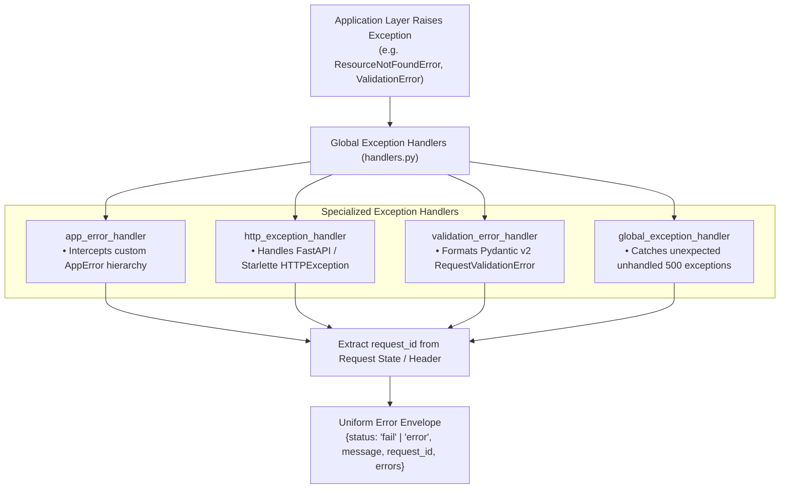

# ⚠️ Exceptions & Error Handling Layer (`app/exceptions`)

The **Exceptions Layer** centralizes domain error modeling, HTTP status translation, and global FastAPI exception handling. It prevents unhandled stack traces from leaking to clients while ensuring standard error response envelopes.

---

## 🏗️ Exception Handling Pipeline



---

## 📁 Module Inventory

| File | Core Component | Description |
|---|---|---|
| [`custom_exceptions.py`](./custom_exceptions.py) | `AppError` Hierarchy | Base domain exception classes with pre-mapped HTTP status codes and user-friendly error messages. |
| [`handlers.py`](./handlers.py) | `register_exception_handlers` | Wires FastAPI exception handlers to format uniform JSON error responses across the entire application lifecycle. |

---

## 📊 Domain Exception Hierarchy

```
AppError (Base Exception, status_code=500)
├── ValidationError (status_code=422)       # Malformed or invalid input payload
├── AuthenticationError (status_code=401)    # Missing/invalid JWT token or bad credentials
├── AuthorizationError (status_code=403)     # Cross-student access or forbidden resource
├── ResourceNotFoundError (status_code=404)  # Student ID not enrolled, record not found
├── ConflictError (status_code=409)          # Duplicate account creation or ticket collision
├── DatabaseError (status_code=500)          # Connection drop or unrecoverable SQL failure
└── ExternalServiceError (status_code=502)   # Groq LLM API or Qdrant vector timeout
```

---

## 💎 Design Standards

- **Informative & Clean Diagnostics**: Every exception carries both a loggable diagnostic string and a clean client message.
- **Fail-Fast**: Enforces hard failures on missing configurations or database disconnects rather than silently degrading into unintended states.
