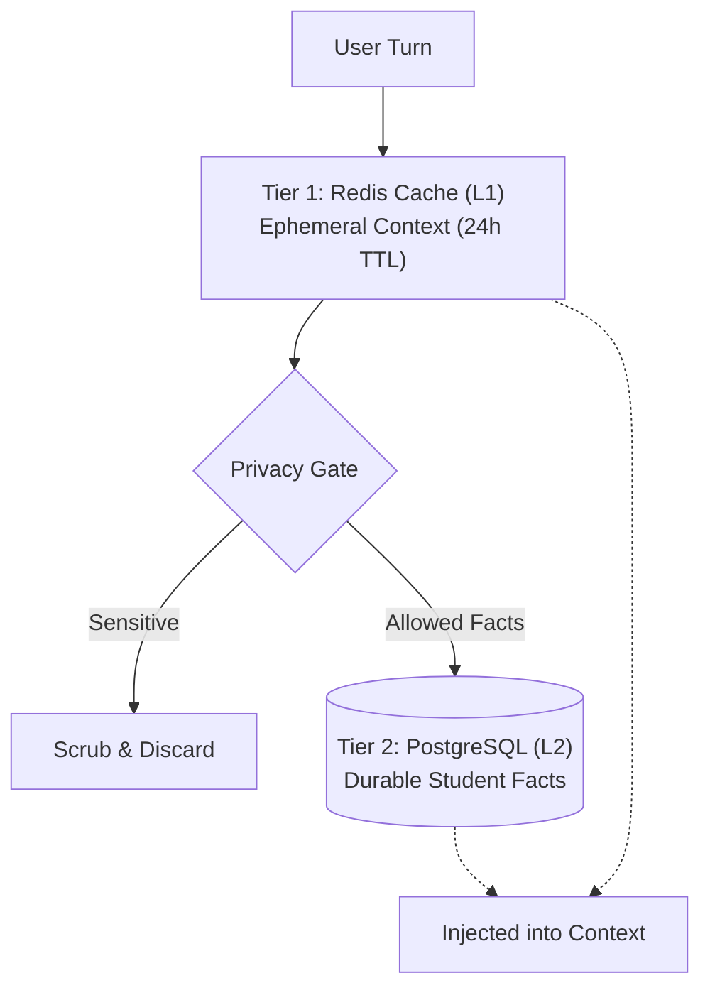

# 🧠 Dual-Tier Memory System (`app/memory`)

The **Memory Layer** manages conversational state and long-term user preferences across multiple turns and sessions. It implements a **privacy-first, dual-tier architecture** combining low-latency ephemeral cache with durable, scrubbed persistence.

---

## 🏗️ Dual-Tier Memory Architecture

---

## 📁 Module Inventory

| File | Core Component | Role & Functionality |
|---|---|---|
| [`memory_manager.py`](./memory_manager.py) | `MemoryManager` | Orchestrates the two-tier lifecycle: loads active context from Redis, filters sensitive topics, extracts durable facts, and injects context into the system prompt. |
| [`redis_memory.py`](./redis_memory.py) | `RedisMemoryStore` | Manages fast JSON-serialized conversation sliding windows in Redis with TTL expiration. |
| [`postgres_memory.py`](./postgres_memory.py) | `PostgresMemoryStore` | Durable PostgreSQL repository performing idempotent key-value fact persistence (`student_memory` table) via native `pg_insert`. |

---

## 🔒 Privacy Scrubbing Categories

The `MemoryManager` strictly scrubs and blocks the following topic categories before writing to PostgreSQL:
- **Medical / Mental Health**: Illness, prescriptions, counseling, disability status.
- **Disciplinary / Legal**: Suspensions, fines, disciplinary committee actions, pending grievances.
- **Financial Details**: Bank account numbers, UPI IDs, fee debt amounts (fees remain strictly in `fee_records`).
- **Authentication Secrets**: Passwords, PINs, OTPs, API keys.
