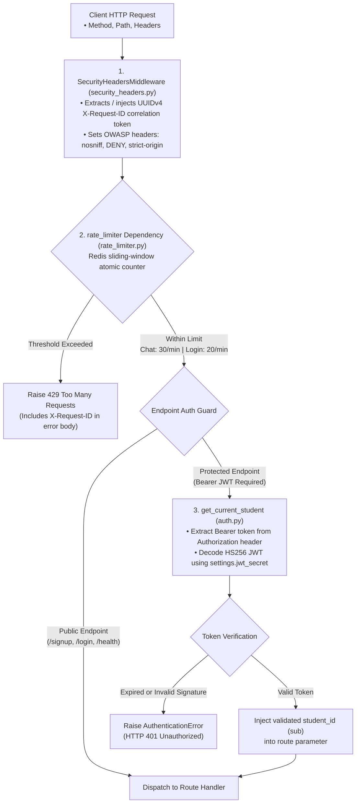

# 🛡️ Middlewares & Security Guards (`app/middlewares`)

The **Middlewares Layer** provides perimeter security, request correlation, rate limiting, and cryptographic authentication guards for incoming HTTP traffic before requests reach route handlers.

---

## 🏗️ Request Guard & Middleware Pipeline

---

## 📁 Module Inventory

| File | Core Component | Role & Functionality |
|---|---|---|
| [`auth.py`](./auth.py) | `get_current_student` | FastAPI dependency that extracts and validates Bearer JWT tokens, ensures valid `exp` timestamp, and yields the authenticated caller's verified `student_id`. |
| [`security_headers.py`](./security_headers.py) | `SecurityHeadersMiddleware` | Pure ASGI middleware that injects distributed `X-Request-ID` correlation tokens and OWASP security headers (`nosniff`, `DENY`, `strict-origin-when-cross-origin`, `1; mode=block`). |
| [`rate_limiter.py`](./rate_limiter.py) | `rate_limiter` | Sliding-window rate limiter dependency using atomic Redis sorted sets with transparent in-memory window fallback. Protects `/chat` (30/min) and `/auth/login` (20/min). |

---

## 🔒 Security Best Practices

1. **Stateless JWT Claims**: Tokens carry the `sub` (student identifier) and `exp` (expiration), avoiding expensive persistent session lookups in the database for every API call.
2. **Deterministic Tenant Ownership**: Because `get_current_student` extracts the identity directly from the cryptographically signed JWT payload, endpoints cannot be deceived by forged query parameters or path variables.
3. **Defense in Depth**: Every layer operates independently: `SecurityHeadersMiddleware` protects the protocol transport, `rate_limiter` protects system resources, and `get_current_student` guards data authorization.
