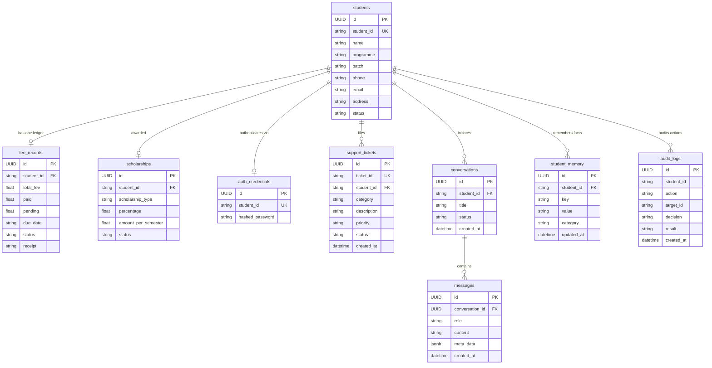

# 🗄️ Relational Models Layer (`app/models`)

The **Models Layer** defines the persistent PostgreSQL relational schema using SQLAlchemy 2.0 Declarative Async Mappings (`Mapped`, `mapped_column`). All tables operate strictly inside the PostgreSQL Docker database container with zero SQLite dependencies.

---

## 🏗️ Entity Relationship Diagram (PostgreSQL)

---

## 📁 Module Inventory

| File | Tables Defined | Description |
|---|---|---|
| [`base.py`](./base.py) | `Base`, `BaseModel` | Declarative Base with automatic `UUID` primary keys and UTC `created_at` / `updated_at` timestamp mixins. |
| [`student_records.py`](./student_records.py) | `students`, `fee_records`, `scholarships`, `support_tickets` | Core university enterprise records: student profiles, tuition ledgers, scholarship awards, and support escalation tickets. |
| [`auth_credentials.py`](./auth_credentials.py) | `auth_credentials` | Stores student login credentials with bcrypt hashed passwords. |
| [`conversation.py`](./conversation.py) | `conversations` | Multi-turn conversational session container linked to student identity. |
| [`message.py`](./message.py) | `messages` | Turn-by-turn prompts, assistant replies, token counts, and step traces using PostgreSQL `JSONB`. |
| [`student_memory.py`](./student_memory.py) | `student_memory` | Durable long-term student facts (career goals, preferences, academic interests) extracted during conversations. |
| [`audit_log.py`](./audit_log.py) | `audit_logs` | Immutable security audit trail recording tool invocations, access decisions, and policy blocks. |
| [`document.py`](./document.py) | `documents` | Ingested PDF document metadata, page counts, chunk tracking, and processing status. |

---

## 💎 Model Principles & Integrity

1. **Pure PostgreSQL JSONB**: Rich metadata in `messages` and `documents` utilizes native PostgreSQL `JSONB` for indexing and query performance.
2. **Referential Integrity**: Cascading deletes (`ondelete="CASCADE"`) guarantee that removing a test student cleans up associated fee records and conversation sessions cleanly.
3. **Immutability of Audit Trails**: `audit_logs` records are append-only to maintain regulatory compliance.
