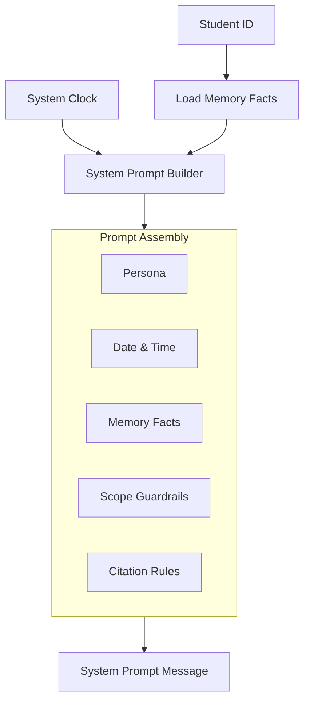

# 📜 Prompts & Persona Engineering (`app/prompts`)

The **Prompts Layer** governs the persona, tone, institutional guardrails, formatting standards, and dynamic context injection for the Intelligent Student Support Agent.

---

## 🏗️ Dynamic Prompt Assembly Flow

---

## 📁 Module Inventory

| File | Core Component | Role & Functionality |
|---|---|---|
| [`system_prompt.py`](./system_prompt.py) | `build_system_prompt`, `BASE_SYSTEM_PROMPT` | Builds dynamic system prompts with injected student memories, guardrails, and date context. |

---

## 🛡️ Guardrail Directives Enforced in System Prompt

1. **Academic Scope Refusal**: Firmly and politely declines non-university queries (e.g., general politics, medical advice, homework essay generation) by guiding the student back to official campus support.
2. **Citation Requirement**: Whenever answering policy, fee, or attendance questions from the student handbook, the agent must provide page number citations (e.g., `[Handbook Page 18]`).
3. **Tone Standards**: Professional, empathetic, concise, and structured with clean markdown headers and bulleted lists.
