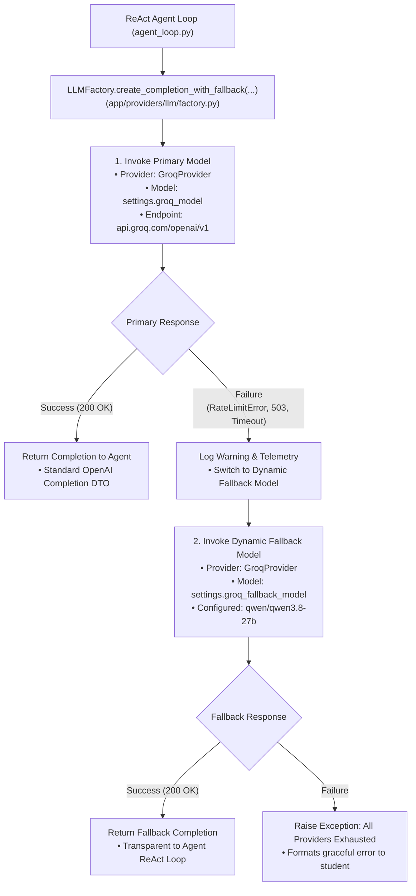

# Providers Layer (`app/providers`)

The **Providers Layer** governs external model provider integrations, client instantiations, configuration resolution, and dynamic multi-tier fallback orchestration for the Intelligent Student Support Agent.

It directly mirrors enterprise multi-model architectural standards (e.g., `knitly-ai-langraph/app/providers`), providing clean separation between low-level API client wire configurations and high-level conversational agent orchestration.

---

## Architecture & Directory Structure

```
app/providers/
├── __init__.py           # Package exports (LLMFactory, GroqProvider)
├── README.md             # Architecture documentation & diagrams
└── llm/
    ├── __init__.py       # Subpackage exports
    ├── factory.py        # Centralized LLM Factory with dynamic model fallback
    ├── groq_provider.py  # Groq client instantiation, timeouts, and retries
    └── openai_provider.py# Optional OpenAI client provider
```

---

## Dynamic Model Fallback Workflow

When an inference turn is initiated in the ReAct agent loop, `LLMFactory` executes the request against the configured primary model (`settings.groq_model`). If the primary model encounters a rate limit, service disruption, or failure, `LLMFactory` intercepts the error and automatically switches execution to the configured dynamic fallback model (`settings.groq_fallback_model` = `qwen/qwen3.8-27b`).



---

## SOLID Principles Adherence

| Principle | Implementation in Providers Layer |
|-----------|-----------------------------------|
| **SRP (Single Responsibility)** | `GroqProvider` is solely responsible for wire credentials and client settings. `LLMFactory` is solely responsible for model fallback orchestration. |
| **OCP (Open/Closed)** | New model providers (e.g. Anthropic, Mistral) or fallback chains can be registered in `LLMFactory` without altering a single line of the ReAct agent loop. |
| **LSP (Liskov Substitution)** | All providers and proxies adhere to standard OpenAI / AsyncOpenAI chat completion wire interfaces. |
| **ISP (Interface Segregation)** | Clean, minimal method signatures (`get_client()`, `get_async_client()`, `create_completion_with_fallback()`). |
| **DIP (Dependency Inversion)** | The agent loop depends upon `LLMFactory` abstractions rather than hardcoded client instances or static model strings. |

---

## Dynamic Configuration via `.env`

All model identifiers are dynamically configurable via environment variables:

```ini
# Primary Groq Model
GROQ_MODEL=openai/gpt-oss-120b

# Dynamic Fallback Model
GROQ_FALLBACK_MODEL=qwen/qwen3.8-27b

# Wire & Inference Parameters
GROQ_API_KEY=gsk_...
GROQ_BASE_URL=https://api.groq.com/openai/v1
AGENT_TEMPERATURE=0.1
AGENT_MAX_TURNS=6
```
