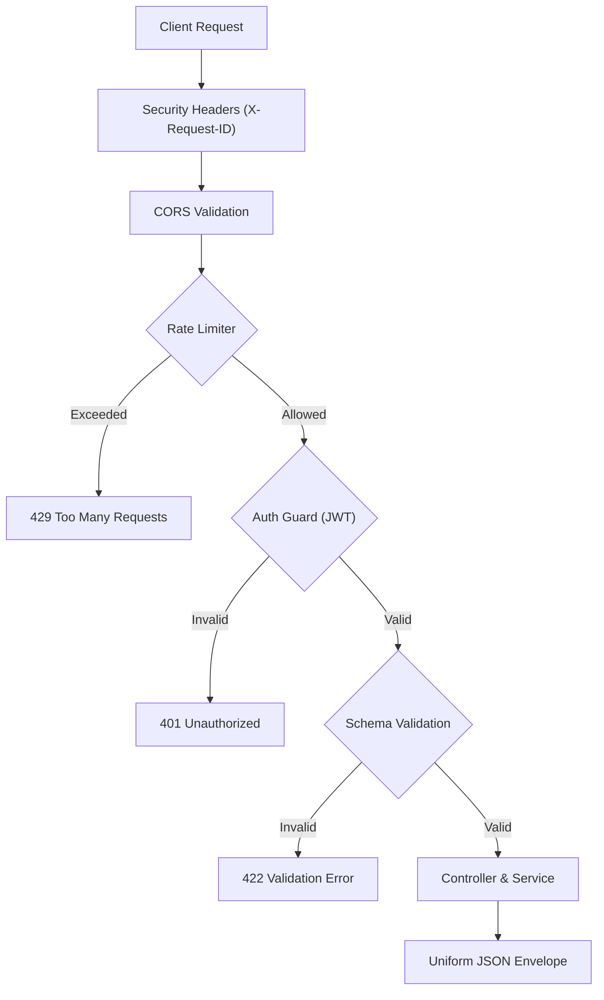
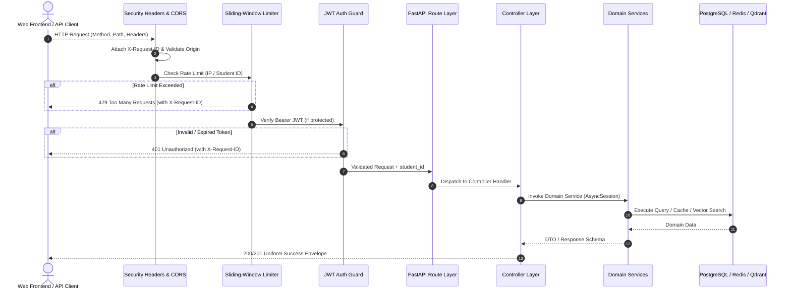

# 🛣️ RESTful API Routes & Endpoint Specifications (`app/routes`)

> **Production-Grade FastAPI Interface for the Intelligent Student Support Agent**  
> *Fully compliant with Clean Architecture, SOLID Principles, OWASP Top 10 API Security, and Assignment 1 & 2 Verification Specifications.*

---

## ⚡ Quick Navigation

| Section | Focus Area |
|---|---|
| 🏗️ **[System Architecture & Security Pipeline](#️-system-architecture--security-pipeline)** | Inbound request filters, middleware chain, and execution flow |
| 📋 **[Uniform JSON Response Envelopes](#-uniform-json-response-envelopes)** | Standardized envelope contracts for Success (`200`/`201`), Client Error (`4xx`), and Server Error (`5xx`) |
| 🛡️ **[Global Security & OWASP Headers Matrix](#️-global-security--owasp-headers-matrix)** | Perimeter security headers, CORS restrictions, and `X-Request-ID` correlation |
| 📊 **[Complete Endpoint Catalog (17 Endpoints)](#-complete-endpoint-catalog-17-endpoints)** | Master index of all available REST routes across the application |
| 🔐 **[1. Authentication & Identity (`/api/v1/auth`)](#1-authentication--identity-apiv1auth)** | Option 2 enrollment, JWT login, credential management, identity verification |
| 💬 **[2. Multi-Turn AI Agent Chat (`/api/v1/chat`)](#2-multi-turn-ai-agent-chat-apiv1chat)** | ReAct loop, Groq fallback model (`qwen/qwen3.8-27b`), sub-second RAG, session management |
| 🎓 **[3. Student Academic Records (`/api/v1/student`)](#3-student-academic-records-apiv1student)** | Profile CRUD, tuition fees, scholarships, and support tickets with strict tenant isolation |
| 🔍 **[4. Security Audit & Compliance (`/api/v1/audit`)](#4-security-audit--compliance-apiv1audit)** | Immutable audit trail query and aggregated compliance metrics |
| 📄 **[5. Handbook Document Ingestion (`/api/v1/ingest`)](#5-handbook-document-ingestion-apiv1ingest)** | Multipart PDF parsing, semantic chunking, and Qdrant vectorization |
| 💓 **[6. Deep Health & Diagnostic Probes (`/health`)](#6-deep-health--diagnostic-probes-health)** | Non-blocking async probes across PostgreSQL, Redis, and Qdrant |
| 👥 **[Student Test Personas Matrix](#-student-test-personas-matrix)** | Pre-seeded accounts (`STU001`–`STU020`) and negative test cases (`STU999`) |
| 🚀 **[End-to-End Curl Testing Guide](#-end-to-end-curl-testing-guide)** | Copy-pasteable verification workflows from registration to agent chat |

---

## 🏗️ System Architecture & Security Pipeline

The `app/routes` layer serves as the declarative HTTP gateway. Every incoming request traverses a multi-layered security and validation perimeter before dispatching to Controllers and Domain Services.

### Request Execution Pipeline





---

## 📋 Uniform JSON Response Envelopes

Every API endpoint adheres strictly to standardized JSON response envelopes, ensuring predictable integration for frontend applications and automated client generators:

### 1. Success Envelope (`200 OK`, `201 Created`)
```json
{
  "status": "success",
  "message": "Operation completed successfully.",
  "data": { ... }
}
```

### 2. Client Failure Envelope (`400`, `401`, `403`, `404`, `409`, `422`, `429`)
```json
{
  "status": "fail",
  "message": "Student ID 'STU999' is not registered in the university roster.",
  "request_id": "9f8c6e28-48b6-4b48-8df0-184517b6a124",
  "errors": null
}
```

### 3. Server Error Envelope (`500 Internal Server Error`, `503 Service Unavailable`)
```json
{
  "status": "error",
  "message": "An unexpected internal server error occurred.",
  "request_id": "9f8c6e28-48b6-4b48-8df0-184517b6a124",
  "errors": "Detailed exception trace logged internally."
}
```

---

## 🛡️ Global Security & OWASP Headers Matrix

| Header | Directives / Format | Architectural Security Purpose |
|---|---|---|
| `Authorization` | `Bearer <JWT_TOKEN>` | Transports authenticated HS256 JWT containing student identifier `sub`. |
| `X-Request-ID` | `UUIDv4` string | Distributed correlation ID attached to all logs, traces, and response headers. |
| `X-Content-Type-Options` | `nosniff` | Prevents browsers from MIME-sniffing away from declared `content-type`. |
| `X-Frame-Options` | `DENY` | Prevents framing and clickjacking attacks in web browsers. |
| `Referrer-Policy` | `strict-origin-when-cross-origin` | Protects sensitive URL parameter leakage across origins. |
| `X-XSS-Protection` | `1; mode=block` | Re-enables legacy browser cross-site scripting filters. |

---

## 📊 Complete Endpoint Catalog (17 Endpoints)

| # | HTTP Method | Endpoint Route | Auth Guard | Rate Limit | Primary Purpose |
|:---:|:---:|---|:---:|:---:|---|
| **1** | `POST` | `/api/v1/auth/signup` | Public | Standard | Enrolls existing student from roster (Option 2) |
| **2** | `POST` | `/api/v1/auth/login` | Public | **20 / min** | Authenticates credentials and issues signed JWT |
| **3** | `POST` | `/api/v1/auth/change-password` | Bearer JWT | Standard | Immediately updates password for authenticated student |
| **4** | `GET` | `/api/v1/auth/me` | Bearer JWT | Standard | Validates token and returns verified identity profile |
| **5** | `POST` | `/api/v1/chat` | Bearer JWT | **30 / min** | Multi-turn ReAct agent reasoning turn with dynamic fallback |
| **6** | `GET` | `/api/v1/chat/conversations` | Bearer JWT | Standard | Lists active and historical chat sessions for student |
| **7** | `GET` | `/api/v1/chat/conversations/{conversation_id}/messages` | Bearer JWT | Standard | Chronological message turns and execution metadata |
| **8** | `DELETE` | `/api/v1/chat/conversations/{conversation_id}` | Bearer JWT | Standard | Deletes conversation session and cascading message turns |
| **9** | `GET` | `/api/v1/student/profile` | Bearer JWT | Standard | Retrieves authenticated student demographic profile |
| **10** | `PUT` | `/api/v1/student/profile` | Bearer JWT | Standard | Updates student phone, email, or mailing address |
| **11** | `GET` | `/api/v1/student/fees` | Bearer JWT | Standard | Retrieves tuition ledger, pending balance, and receipts |
| **12** | `GET` | `/api/v1/student/scholarship` | Bearer JWT | Standard | Retrieves active financial grant and renewal criteria |
| **13** | `GET` | `/api/v1/student/tickets` | Bearer JWT | Standard | Retrieves grievance and support escalation tickets |
| **14** | `GET` | `/api/v1/audit/logs` | Public / Internal | Standard | Queries immutable security audit trail with filters |
| **15** | `GET` | `/api/v1/audit/summary` | Public / Internal | Standard | Aggregated compliance metrics for Assignment 2 |
| **16** | `POST` | `/api/v1/ingest` | Public / Internal | Standard | Multipart PDF handbook upload, chunking, and embedding |
| **17** | `GET` | `/health` | Public | None | Deep multi-dependency probe (PostgreSQL, Redis, Qdrant) |

---

## 1. Authentication & Identity (`/api/v1/auth`)

### 1.1 Self-Service Student Enrollment (`POST /api/v1/auth/signup`)

Enrolls an existing university student into portal credentials (**Assignment 2 Option 2 Implementation**). Pre-validates that the `student_id` exists in the university roster (`students` table). Prevents identity spoofing.

- **HTTP Method**: `POST`
- **Route**: `/api/v1/auth/signup`
- **Authentication**: None (Public)
- **Rate Limit**: Standard
- **Request Headers**:
  - `Content-Type: application/json`

#### Request Body Schema (`SignupRequest`)
| Field | Type | Required | Constraints | Description |
|---|---|:---:|---|---|
| `student_id` | `string` | Yes | Valid format (e.g. `STU006`) | Registered student ID in university system |
| `password` | `string` | Yes | Min 8 characters | Initial account password |

```json
{
  "student_id": "STU006",
  "password": "SecurePassword@123"
}
```

#### Successful Response (`201 Created`)
```json
{
  "status": "success",
  "message": "Account created successfully. You can now log in.",
  "data": {
    "student_id": "STU006",
    "name": "Kavita Reddy",
    "programme": "BBA",
    "batch": "2024-2027"
  }
}
```

#### Error Scenarios
| HTTP Status | Error Reason | Response Envelope |
|---|---|---|
| `400 Bad Request` | Password shorter than 8 characters | `{"status": "fail", "message": "Password must be at least 8 characters", "request_id": "...", "errors": null}` |
| `404 Not Found` | Student ID not in university roster | `{"status": "fail", "message": "Student ID 'STU999' is not registered in the university roster.", "request_id": "...", "errors": null}` |
| `409 Conflict` | Student already enrolled credentials | `{"status": "fail", "message": "Student 'STU001' already has an active account. Please log in.", "request_id": "...", "errors": null}` |

#### Curl Command
```bash
curl -X POST http://localhost:8000/api/v1/auth/signup \
  -H "Content-Type: application/json" \
  -d '{"student_id": "STU006", "password": "SecurePassword@123"}'
```

---

### 1.2 Student Authentication & JWT Login (`POST /api/v1/auth/login`)

Authenticates student credentials via bcrypt hash comparison and issues a signed HS256 JWT access token valid for 24 hours.

- **HTTP Method**: `POST`
- **Route**: `/api/v1/auth/login`
- **Authentication**: None (Public)
- **Rate Limit**: **20 requests / minute** (Redis sliding-window limiter)
- **Request Headers**:
  - `Content-Type: application/json`

#### Request Body Schema (`LoginRequest`)
| Field | Type | Required | Description |
|---|---|:---:|---|
| `student_id` | `string` | Yes | Student identifier (e.g. `STU001`) |
| `password` | `string` | Yes | Plaintext password |

```json
{
  "student_id": "STU001",
  "password": "Student@123"
}
```

#### Successful Response (`200 OK`)
```json
{
  "status": "success",
  "message": "Authentication successful.",
  "data": {
    "access_token": "eyJhbGciOiJIUzI1NiIsInR5cCI6IkpXVCJ9.eyJzdWIiOiJTVFUwMDEiLCJleHAiOjE3NjE1NzA0MTN9...",
    "token_type": "bearer",
    "expires_in": 86400
  }
}
```

#### Error Scenarios
| HTTP Status | Error Reason | Response Envelope |
|---|---|---|
| `401 Unauthorized` | Invalid password or credentials not enrolled | `{"status": "fail", "message": "Invalid student ID or password.", "request_id": "...", "errors": null}` |
| `429 Too Many Requests` | Exceeded 20 login attempts in 60s | `{"status": "fail", "message": "Rate limit exceeded. Maximum 20 requests per 60s.", "request_id": "...", "errors": null}` |

#### Curl Command
```bash
curl -X POST http://localhost:8000/api/v1/auth/login \
  -H "Content-Type: application/json" \
  -d '{"student_id": "STU001", "password": "Student@123"}'
```

---

### 1.3 Change Password (`POST /api/v1/auth/change-password`)

Updates the password hash in the `auth_credentials` table for the authenticated student.

- **HTTP Method**: `POST`
- **Route**: `/api/v1/auth/change-password`
- **Authentication**: `Bearer <JWT>`
- **Rate Limit**: Standard
- **Request Headers**:
  - `Authorization: Bearer <token>`
  - `Content-Type: application/json`

#### Request Body Schema (`ChangePasswordRequest`)
| Field | Type | Required | Constraints | Description |
|---|---|:---:|---|---|
| `new_password` | `string` | Yes | Min 6 characters | New secure password string |

```json
{
  "new_password": "NewSecretPassword@456"
}
```

#### Successful Response (`200 OK`)
```json
{
  "status": "success",
  "message": "Password updated successfully.",
  "data": null
}
```

#### Error Scenarios
| HTTP Status | Error Reason | Response Envelope |
|---|---|---|
| `401 Unauthorized` | Missing or expired JWT token | `{"status": "fail", "message": "Could not validate credentials.", "request_id": "...", "errors": null}` |
| `422 Unprocessable Entity` | Password shorter than 6 characters | `{"status": "fail", "message": "Validation error", "request_id": "...", "errors": [...]}` |

#### Curl Command
```bash
curl -X POST http://localhost:8000/api/v1/auth/change-password \
  -H "Authorization: Bearer $TOKEN" \
  -H "Content-Type: application/json" \
  -d '{"new_password": "NewSecretPassword@456"}'
```

---

### 1.4 Verify Current User Identity (`GET /api/v1/auth/me`)

Validates the incoming JWT bearer token and confirms authenticated student status.

- **HTTP Method**: `GET`
- **Route**: `/api/v1/auth/me`
- **Authentication**: `Bearer <JWT>`
- **Rate Limit**: Standard
- **Request Headers**:
  - `Authorization: Bearer <token>`

#### Successful Response (`200 OK`)
```json
{
  "status": "success",
  "message": "Token is valid.",
  "data": {
    "student_id": "STU001",
    "authenticated": true
  }
}
```

#### Curl Command
```bash
curl -H "Authorization: Bearer $TOKEN" http://localhost:8000/api/v1/auth/me
```

---

## 2. Multi-Turn AI Agent Chat (`/api/v1/chat`)

### 2.1 Send Message to AI Agent (`POST /api/v1/chat`)

Executes an interactive **ReAct reasoning loop** turn. Features:
- **Two-Tier Memory**: Ingests recent turns from Redis (L1) and permanent student facts from PostgreSQL (L2).
- **Dynamic Model Fallback**: Primary Groq model (`groq_model`) with automatic failover to `qwen/qwen3.8-27b` (`groq_fallback_model`) via `LLMFactory`.
- **Sub-Second RAG**: Handbook retrieval accelerated via RAM pre-warming, in-memory LRU cache, and Redis 24h caching (**2.3 ms cached query latency**).
- **Automated Safety Gate**: Suspends execution with `pending_approval: true` if the agent detects a sensitive action (e.g. fee waiver or credential update).

- **HTTP Method**: `POST`
- **Route**: `/api/v1/chat`
- **Authentication**: `Bearer <JWT>`
- **Rate Limit**: **30 requests / minute** (Redis sliding-window limiter)
- **Request Headers**:
  - `Authorization: Bearer <token>`
  - `Content-Type: application/json`

#### Request Body Schema (`ChatRequest`)
| Field | Type | Required | Description |
|---|---|:---:|---|
| `message` | `string` | Yes | Student natural language query or approval response |
| `conversation_id` | `UUID` | No | Ongoing conversation UUID. If omitted, a new conversation session is created. |

```json
{
  "message": "What is my tuition fee balance, and what is the penalty if I pay late?",
  "conversation_id": "9f8c6e28-48b6-4b48-8df0-184517b6a124"
}
```

#### Successful Response (`200 OK`)
```json
{
  "status": "success",
  "message": "Agent response generated successfully.",
  "data": {
    "conversation_id": "9f8c6e28-48b6-4b48-8df0-184517b6a124",
    "message": "Your pending tuition balance is ₹2,25,000 due on October 31, 2026. According to Section 4.2 of the Student Handbook, late fee payments incur a surcharge of ₹500 per day up to 15 days.",
    "role": "assistant",
    "trace_id": "c71a8f90",
    "facts_learned": [
      "inquired_fee_due_date_oct_31"
    ],
    "pending_approval": false,
    "trace": {
      "duration_ms": 185.4,
      "total_tokens": 1240,
      "model": "llama-3.3-70b-versatile",
      "steps": [
        {
          "type": "tool_call",
          "tool_name": "get_fee_status",
          "args": {"student_id": "STU001"}
        },
        {
          "type": "tool_call",
          "tool_name": "search_student_handbook",
          "args": {"query": "late fee payment surcharge penalty"}
        }
      ]
    }
  }
}
```

#### Error Scenarios
| HTTP Status | Error Reason | Response Envelope |
|---|---|---|
| `401 Unauthorized` | Missing or invalid Bearer JWT | `{"status": "fail", "message": "Could not validate credentials.", "request_id": "...", "errors": null}` |
| `429 Too Many Requests` | Exceeded 30 requests / minute | `{"status": "fail", "message": "Rate limit exceeded. Maximum 30 requests per 60s.", "request_id": "...", "errors": null}` |

#### Curl Command
```bash
curl -X POST http://localhost:8000/api/v1/chat \
  -H "Authorization: Bearer $TOKEN" \
  -H "Content-Type: application/json" \
  -d '{"message": "What is my fee balance?"}'
```

---

### 2.2 List Student Conversations (`GET /api/v1/chat/conversations`)

Retrieves a summary list of all chat sessions initiated by the authenticated student.

- **HTTP Method**: `GET`
- **Route**: `/api/v1/chat/conversations`
- **Authentication**: `Bearer <JWT>`
- **Rate Limit**: Standard
- **Request Headers**:
  - `Authorization: Bearer <token>`

#### Successful Response (`200 OK`)
```json
{
  "status": "success",
  "message": "Retrieved 1 conversations.",
  "data": [
    {
      "id": "9f8c6e28-48b6-4b48-8df0-184517b6a124",
      "student_id": "STU001",
      "title": "Fee Balance & Late Payment Policy",
      "status": "active",
      "created_at": "2026-10-24T10:15:00Z",
      "message_count": 4
    }
  ]
}
```

#### Curl Command
```bash
curl -H "Authorization: Bearer $TOKEN" http://localhost:8000/api/v1/chat/conversations
```

---

### 2.3 Get Conversation Turn History (`GET /api/v1/chat/conversations/{conversation_id}/messages`)

Retrieves chronological turns, message roles, and metadata for a specific conversation session owned by the authenticated student.

- **HTTP Method**: `GET`
- **Route**: `/api/v1/chat/conversations/{conversation_id}/messages`
- **Authentication**: `Bearer <JWT>`
- **Rate Limit**: Standard
- **Path Parameters**:
  - `conversation_id` (`UUID`, Required): Conversation identifier

#### Successful Response (`200 OK`)
```json
{
  "status": "success",
  "message": "Retrieved 2 messages.",
  "data": [
    {
      "id": "b3f0248a-6b45-4e31-8f43-85b4f2c253c1",
      "role": "user",
      "content": "What is my remaining fee balance?",
      "meta_data": null,
      "created_at": "2026-10-24T10:15:00Z"
    },
    {
      "id": "c4d1259b-7c56-5f42-9a54-96c5e3d364d2",
      "role": "assistant",
      "content": "You have ₹2,25,000 due on October 31, 2026.",
      "meta_data": {
        "trace_id": "c71a8f90"
      },
      "created_at": "2026-10-24T10:15:02Z"
    }
  ]
}
```

#### Error Scenarios
| HTTP Status | Error Reason | Response Envelope |
|---|---|---|
| `404 Not Found` | Session not found or owned by another student | `{"status": "fail", "message": "Conversation session not found.", "request_id": "...", "errors": null}` |

#### Curl Command
```bash
curl -H "Authorization: Bearer $TOKEN" \
  http://localhost:8000/api/v1/chat/conversations/9f8c6e28-48b6-4b48-8df0-184517b6a124/messages
```

---

### 2.4 Delete Conversation Session (`DELETE /api/v1/chat/conversations/{conversation_id}`)

Permanently deletes a conversation session and all its associated message turns from PostgreSQL.

- **HTTP Method**: `DELETE`
- **Route**: `/api/v1/chat/conversations/{conversation_id}`
- **Authentication**: `Bearer <JWT>`
- **Rate Limit**: Standard
- **Path Parameters**:
  - `conversation_id` (`UUID`, Required): Conversation identifier

#### Successful Response (`200 OK`)
```json
{
  "status": "success",
  "message": "Conversation deleted successfully.",
  "data": {
    "conversation_id": "9f8c6e28-48b6-4b48-8df0-184517b6a124"
  }
}
```

#### Curl Command
```bash
curl -X DELETE -H "Authorization: Bearer $TOKEN" \
  http://localhost:8000/api/v1/chat/conversations/9f8c6e28-48b6-4b48-8df0-184517b6a124
```

---

## 3. Student Academic Records (`/api/v1/student`)

All student record endpoints enforce **code-level tenant ownership**. A student token can **only** inspect and modify their own records. Cross-student data requests are strictly blocked and create an immutable audit record.

### 3.1 Get Student Profile (`GET /api/v1/student/profile`)

Returns demographic, academic programme, batch, and contact details for the authenticated student.

- **HTTP Method**: `GET`
- **Route**: `/api/v1/student/profile`
- **Authentication**: `Bearer <JWT>`
- **Rate Limit**: Standard
- **Request Headers**:
  - `Authorization: Bearer <token>`

#### Successful Response (`200 OK`)
```json
{
  "status": "success",
  "message": "Student profile retrieved successfully.",
  "data": {
    "student_id": "STU001",
    "name": "Rahul Sharma",
    "programme": "PGDM AI & DS",
    "batch": "2024-2026",
    "status": "active",
    "phone": "+91-9876543210",
    "email": "rahul.sharma@university.edu",
    "address": "42 Tech Park, Whitefield, Bengaluru"
  }
}
```

#### Curl Command
```bash
curl -H "Authorization: Bearer $TOKEN" http://localhost:8000/api/v1/student/profile
```

---

### 3.2 Update Student Contact Details (`PUT /api/v1/student/profile`)

Updates phone, email, or mailing address directly in the PostgreSQL `students` table. Logs an audit entry.

- **HTTP Method**: `PUT`
- **Route**: `/api/v1/student/profile`
- **Authentication**: `Bearer <JWT>`
- **Rate Limit**: Standard
- **Request Headers**:
  - `Authorization: Bearer <token>`
  - `Content-Type: application/json`

#### Request Body Schema (`UpdateProfileRequest`)
| Field | Type | Required | Description |
|---|---|:---:|---|
| `phone` | `string` | No | New contact phone number |
| `email` | `string` | No | New contact email address |
| `address` | `string` | No | New residential or mailing address |

```json
{
  "phone": "+91-9988776655",
  "address": "Flat 302, Cyber Heights, Bengaluru"
}
```

#### Successful Response (`200 OK`)
```json
{
  "status": "success",
  "message": "Student profile updated successfully.",
  "data": {
    "student_id": "STU001",
    "name": "Rahul Sharma",
    "programme": "PGDM AI & DS",
    "batch": "2024-2026",
    "status": "active",
    "phone": "+91-9988776655",
    "email": "rahul.sharma@university.edu",
    "address": "Flat 302, Cyber Heights, Bengaluru"
  }
}
```

#### Curl Command
```bash
curl -X PUT http://localhost:8000/api/v1/student/profile \
  -H "Authorization: Bearer $TOKEN" \
  -H "Content-Type: application/json" \
  -d '{"phone": "+91-9988776655", "address": "Flat 302, Cyber Heights, Bengaluru"}'
```

---

### 3.3 Get Tuition Fee Ledger (`GET /api/v1/student/fees`)

Retrieves the authenticated student's financial tuition ledger, total obligations, paid amounts, outstanding balance, due date, and receipt ID.

- **HTTP Method**: `GET`
- **Route**: `/api/v1/student/fees`
- **Authentication**: `Bearer <JWT>`
- **Rate Limit**: Standard
- **Request Headers**:
  - `Authorization: Bearer <token>`

#### Successful Response (`200 OK`)
```json
{
  "status": "success",
  "message": "Fee ledger retrieved successfully.",
  "data": {
    "student_id": "STU001",
    "total_fee": 450000.0,
    "paid": 225000.0,
    "pending": 225000.0,
    "due_date": "2026-10-31",
    "status": "partially_paid",
    "receipt": "RCP-2024-001"
  }
}
```

#### Curl Command
```bash
curl -H "Authorization: Bearer $TOKEN" http://localhost:8000/api/v1/student/fees
```

---

### 3.4 Get Scholarship Details (`GET /api/v1/student/scholarship`)

Retrieves active scholarship grant, percentage deduction, per-semester award, and renewal status.

- **HTTP Method**: `GET`
- **Route**: `/api/v1/student/scholarship`
- **Authentication**: `Bearer <JWT>`
- **Rate Limit**: Standard
- **Request Headers**:
  - `Authorization: Bearer <token>`

#### Successful Response (`200 OK`)
```json
{
  "status": "success",
  "message": "Scholarship details retrieved successfully.",
  "data": {
    "student_id": "STU001",
    "scholarship_type": "Merit Excellence",
    "percentage": 20.0,
    "amount_per_semester": 45000.0,
    "status": "active"
  }
}
```

*Note: If the student has no active scholarship, `data: null` is returned with message `"No active scholarship award on record."`.*

#### Curl Command
```bash
curl -H "Authorization: Bearer $TOKEN" http://localhost:8000/api/v1/student/scholarship
```

---

### 3.5 Get Support & Grievance Tickets (`GET /api/v1/student/tickets`)

Retrieves support escalation tickets created by or on behalf of the authenticated student.

- **HTTP Method**: `GET`
- **Route**: `/api/v1/student/tickets`
- **Authentication**: `Bearer <JWT>`
- **Rate Limit**: Standard
- **Request Headers**:
  - `Authorization: Bearer <token>`

#### Successful Response (`200 OK`)
```json
{
  "status": "success",
  "message": "Retrieved 1 support tickets.",
  "data": [
    {
      "ticket_id": "TICK-2026-0042",
      "student_id": "STU001",
      "category": "Fee Extension",
      "description": "Request for 15-day installment deferral due to banking delay",
      "priority": "medium",
      "status": "in_progress",
      "created_at": "2026-10-20T14:30:00Z"
    }
  ]
}
```

#### Curl Command
```bash
curl -H "Authorization: Bearer $TOKEN" http://localhost:8000/api/v1/student/tickets
```

---

## 4. Security Audit & Compliance (`/api/v1/audit`)

### 4.1 List Security Audit Logs (`GET /api/v1/audit/logs`)

Inspects immutable security trails recorded in PostgreSQL for tool invocations and access control decisions (**Assignment 2 Compliance Requirement**).

- **HTTP Method**: `GET`
- **Route**: `/api/v1/audit/logs`
- **Authentication**: Public / Internal
- **Rate Limit**: Standard
- **Query Parameters**:
  | Parameter | Type | Required | Default | Constraints | Description |
  |---|---|:---:|:---:|---|---|
  | `limit` | `integer` | No | `50` | `1` to `200` | Maximum number of logs to return |
  | `decision` | `string` | No | `None` | `ALLOWED`, `BLOCKED`, `APPROVED`, `REJECTED` | Filter logs by decision outcome |

#### Successful Response (`200 OK`)
```json
{
  "status": "success",
  "message": "Retrieved 2 audit log records.",
  "data": [
    {
      "id": "e4f8d220-4b57-410a-8d19-9f44a80e1234",
      "student_id": "STU001",
      "action": "get_fee_status",
      "target_id": "STU002",
      "decision": "BLOCKED",
      "result": "Access denied: student STU001 cannot query data for student STU002",
      "created_at": "2026-10-24T10:15:01Z"
    },
    {
      "id": "f5a9e331-5c68-421b-9e20-0a55b91f2345",
      "student_id": "STU001",
      "action": "get_fee_status",
      "target_id": "STU001",
      "decision": "ALLOWED",
      "result": "Fee inquiry completed for STU001",
      "created_at": "2026-10-24T10:14:55Z"
    }
  ]
}
```

#### Curl Command
```bash
curl "http://localhost:8000/api/v1/audit/logs?limit=10&decision=BLOCKED"
```

---

### 4.2 Aggregated Compliance Summary (`GET /api/v1/audit/summary`)

Calculates live compliance statistics and decision breakdowns for formal Assignment 2 evaluation.

- **HTTP Method**: `GET`
- **Route**: `/api/v1/audit/summary`
- **Authentication**: Public / Internal
- **Rate Limit**: Standard

#### Successful Response (`200 OK`)
```json
{
  "status": "success",
  "message": "Audit summary calculated successfully.",
  "data": {
    "total_events": 142,
    "allowed_count": 118,
    "blocked_count": 14,
    "approved_count": 7,
    "rejected_count": 3,
    "recent_logs": [ ... ]
  }
}
```

#### Curl Command
```bash
curl http://localhost:8000/api/v1/audit/summary
```

---

## 5. Handbook Document Ingestion (`/api/v1/ingest`)

### 5.1 Upload & Vectorize Handbook PDF (`POST /api/v1/ingest`)

Uploads, validates, parses, chunks, and embeds university policy documents into Qdrant vector storage (`student_handbook` collection) and creates an ingestion audit record in PostgreSQL.

- **HTTP Method**: `POST`
- **Route**: `/api/v1/ingest`
- **Authentication**: Public / Internal
- **Rate Limit**: Standard
- **Content-Type**: `multipart/form-data`

#### Request Parameters
| Parameter | Type | Required | Description |
|---|---|:---:|---|
| `file` | `UploadFile` (binary) | Yes | PDF handbook document (`application/pdf`) |

#### Successful Response (`201 Created`)
```json
{
  "status": "success",
  "message": "Document 'student_handbook.pdf' successfully parsed, chunked, and embedded into Qdrant.",
  "data": {
    "filename": "student_handbook.pdf",
    "chunks_created": 184,
    "embedding_model": "Orange/orange-nomic-v1.5-1536",
    "vector_collection": "student_handbook"
  }
}
```

#### Error Scenarios
| HTTP Status | Error Reason | Response Envelope |
|---|---|---|
| `400 Bad Request` | Uploaded file is empty or not a PDF | `{"status": "fail", "message": "Only PDF files are supported for ingestion.", "request_id": "...", "errors": null}` |

#### Curl Command
```bash
curl -X POST http://localhost:8000/api/v1/ingest \
  -F "file=@/path/to/student_handbook.pdf"
```

---

## 6. Deep Health & Diagnostic Probes (`/health`)

### 6.1 Multi-Dependency Deep Probe (`GET /health`)

Executes live, non-blocking asynchronous probes across all core backend dependencies:
1. **PostgreSQL**: Probes connection pool via `SELECT 1`.
2. **Redis**: Pings cache for `PONG` response.
3. **Qdrant**: Checks vector store connectivity via `client.get_collections()`.

- **HTTP Method**: `GET`
- **Route**: `/health`
- **Authentication**: None (Public)
- **Rate Limit**: None

#### Successful Response (`200 OK` - Healthy)
```json
{
  "status": "healthy",
  "app": "Intelligent Student Support Agent",
  "environment": "development",
  "dependencies": {
    "database": {
      "status": "healthy",
      "type": "postgresql",
      "message": "Connected"
    },
    "cache": {
      "status": "healthy",
      "type": "redis",
      "message": "PONG"
    },
    "vector_db": {
      "status": "healthy",
      "type": "qdrant",
      "message": "Connected"
    }
  }
}
```

#### Degraded Response (`200 OK` - Cache Degraded)
```json
{
  "status": "degraded",
  "app": "Intelligent Student Support Agent",
  "environment": "development",
  "dependencies": {
    "database": {
      "status": "healthy",
      "type": "postgresql",
      "message": "Connected"
    },
    "cache": {
      "status": "degraded",
      "type": "redis",
      "message": "Redis unreachable (in-memory/Postgres fallback)"
    },
    "vector_db": {
      "status": "healthy",
      "type": "qdrant",
      "message": "Connected"
    }
  }
}
```

#### Critical Failure Response (`503 Service Unavailable` - Database Down)
When the primary PostgreSQL database is unreachable, the endpoint returns HTTP status `503 Service Unavailable` indicating the system cannot process requests.

#### Curl Command
```bash
curl http://localhost:8000/health
```

---

## 👥 Student Test Personas Matrix

The PostgreSQL database is pre-seeded with **20 comprehensive student records** (`STU001` through `STU020`) via `just seed`:

| Student ID | Full Name | Programme | Fee Ledger Status | Scholarship | Account Status | Testing Purpose |
|:---:|---|---|---|---|:---:|---|
| **`STU001`** | **Rahul Sharma** | PGDM AI & DS | Partially Paid (₹225k due Oct 31) | 20% Merit (Active) | Pre-Activated (`Student@123`) | Standard fee balance & policy queries |
| **`STU002`** | **Priya Patel** | MBA Marketing | Paid in Full (₹0 due) | None | Pre-Activated (`Student@123`) | Verified paid-in-full queries |
| **`STU003`** | **Amit Verma** | B.Tech CSE | Overdue (₹200k since Sept 1) | 15% Sports (Active) | Pre-Activated (`Student@123`) | Late payment penalty verification |
| **`STU004`** | **Sneha Gupta** | M.Tech Data Science | Unpaid (₹380k due Nov 15) | 25% Research (Active) | Pre-Activated (`Student@123`) | Extension ticket creation testing |
| **`STU005`** | **Vikram Malhotra** | BBA Analytics | Partially Paid (₹150k due Dec 1) | None | Pre-Activated (`Student@123`) | Multi-turn conversational flow |
| **`STU006`**–**`STU020`** | Diverse Cohort | Various | Varied ledgers | Various | **Not Activated** | Available for `POST /signup` testing |
| **`STU999`** | Invalid Student | None | None | None | **Not in Roster** | Negative test (verifies `404 Not Found`) |

---

## 🚀 End-to-End Curl Testing Guide

Execute the following sequential curl commands in your terminal to verify the entire system lifecycle:

```bash
# ==============================================================================
# 1. SYSTEM HEALTH PROBE
# ==============================================================================
curl -s http://localhost:8000/health | jq .

# ==============================================================================
# 2. ENROLL NEW STUDENT (OPTION 2 ENROLLMENT)
# ==============================================================================
curl -s -X POST http://localhost:8000/api/v1/auth/signup \
  -H "Content-Type: application/json" \
  -d '{"student_id": "STU006", "password": "SecurePassword@123"}' | jq .

# ==============================================================================
# 3. AUTHENTICATE AND OBTAIN JWT ACCESS TOKEN
# ==============================================================================
TOKEN=$(curl -s -X POST http://localhost:8000/api/v1/auth/login \
  -H "Content-Type: application/json" \
  -d '{"student_id": "STU001", "password": "Student@123"}' | jq -r '.data.access_token')

echo "Acquired Bearer Token: $TOKEN"

# ==============================================================================
# 4. VERIFY AUTHENTICATED IDENTITY
# ==============================================================================
curl -s -H "Authorization: Bearer $TOKEN" http://localhost:8000/api/v1/auth/me | jq .

# ==============================================================================
# 5. QUERY TUITION FEE LEDGER
# ==============================================================================
curl -s -H "Authorization: Bearer $TOKEN" http://localhost:8000/api/v1/student/fees | jq .

# ==============================================================================
# 6. ASK AI SUPPORT AGENT (SUB-SECOND RAG RETRIEVAL)
# ==============================================================================
curl -s -X POST http://localhost:8000/api/v1/chat \
  -H "Authorization: Bearer $TOKEN" \
  -H "Content-Type: application/json" \
  -d '{"message": "What is the minimum attendance requirement for final examinations?"}' | jq .

# ==============================================================================
# 7. CROSS-STUDENT INQUIRY BLOCK TEST (ATTEMPTING TO QUERY STU002 AS STU001)
# ==============================================================================
curl -s -X POST http://localhost:8000/api/v1/chat \
  -H "Authorization: Bearer $TOKEN" \
  -H "Content-Type: application/json" \
  -d '{"message": "Can you check the fee status for student STU002?"}' | jq .

# ==============================================================================
# 8. INSPECT AUDIT LOG FOR THE BLOCKED ATTEMPT
# ==============================================================================
curl -s "http://localhost:8000/api/v1/audit/logs?limit=5&decision=BLOCKED" | jq .

# ==============================================================================
# 9. GET AGGREGATED COMPLIANCE SUMMARY
# ==============================================================================
curl -s http://localhost:8000/api/v1/audit/summary | jq .
```

---

*Documentation maintained by AI Code Review Agent. Interactive documentation is available live at [`http://localhost:8000/docs`](http://localhost:8000/docs).*
