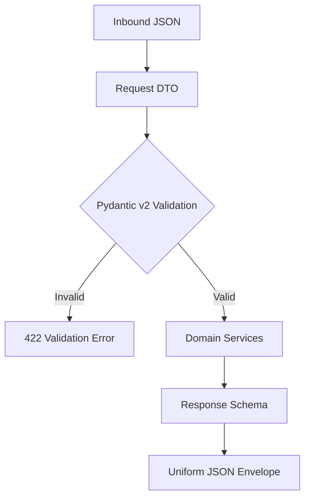

# 📋 Schemas & Data Contracts Layer (`app/schemas`)

The **Schemas Layer** defines Pydantic v2 models for inbound request validation, outbound response serialization, and OpenAI function calling tool signatures.

---

## 🏗️ Data Validation & Serialization Flow

---

## 📁 Module Inventory

| File / Folder | Core Schemas | Role & Description |
|---|---|---|
| [`auth_schema.py`](./auth_schema.py) | `SignupRequest`, `LoginRequest`, `TokenResponse` | Validates registration student IDs and passwords; serializes JWT access token responses. |
| [`chat_schema.py`](./chat_schema.py) | `ChatRequest`, `ChatResponse`, `CitationDTO` | Validates user prompts and conversation IDs; structures AI responses with citations, traces, and metadata. |
| [`student_schema.py`](./student_schema.py) | `StudentProfileDTO`, `FeeRecordDTO`, `ScholarshipDTO`, `UpdateProfileRequest` | Shapes student records for web clients and validates contact update requests. |
| [`approval_schema.py`](./approval_schema.py) | `ApprovalRequest`, `ApprovalResponse` | Handles human-in-the-loop approvals for sensitive modifications (e.g., fee extensions). |
| [`audit_schema.py`](./audit_schema.py) | `AuditLogDTO`, `AuditSummaryResponse` | Structures compliance log streams and security event aggregations. |
| [`memory_schema.py`](./memory_schema.py) | `StudentFactDTO`, `MemorySummaryResponse` | Validates durable key-value memory facts extracted by the conversational agent. |
| [`tool_schemas.py`](./tool_schemas.py) | `AGENT_TOOLS` | OpenAI-compatible JSON function definitions for agent tool execution (fees, scholarships, tickets, handbook RAG). |
| [`tools/`](./tools/) | Modular Tool Parameter Schemas | Parameter definitions for specific agent tools (`auth_schema.py`, `profile_schema.py`, `ticket_schema.py`). |

---

## 💎 Validation & Type Safety Standards

- **Strict Input Sanitization**: Prevents empty strings or injection payloads from entering the service layer.
- **Data Encapsulation**: Passwords and internal SQLAlchemy database references are strictly excluded from response models.
- **OpenAI Tool Compliance**: Tool schemas strictly adhere to JSON Schema specifications required by Groq and OpenAI function-calling APIs.
