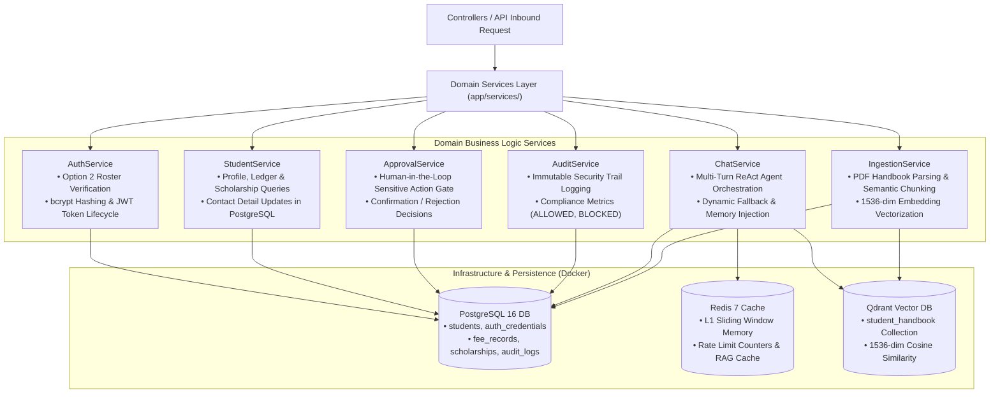

# ⚙️ Services Layer (`app/services`)

The **Services Layer** contains the core domain logic, transactional rules, identity lifecycles, and agent orchestration routines of the system. It strictly isolates business workflows from both HTTP transport concerns and raw database driver details.

---

## 🏗️ Domain Service Architecture

---

## 📁 Module Inventory

| File | Service Class | Primary Domain Responsibilities |
|---|---|---|
| [`auth_service.py`](./auth_service.py) | `AuthService` | Verifies university enrollment (Option 2), hashes passwords with bcrypt, signs JWT tokens, and validates student credentials. |
| [`chat_service.py`](./chat_service.py) | `ChatService` | Manages the end-to-end conversational agent loop: memory retrieval, OpenAI function calling, database tool dispatch, and citation assembly. |
| [`student_service.py`](./student_service.py) | `StudentService` | Retrieves authenticated student directory info, fee payment ledgers, active scholarship awards, and support tickets from PostgreSQL. |
| [`approval_service.py`](./approval_service.py) | `ApprovalService` | Evaluates whether sensitive student requests (e.g., fee installment extension, profile updates) require human administrative review. |
| [`audit_service.py`](./audit_service.py) | `AuditService` | Writes tamper-resistant audit records (`audit_logs` table) for security events, tool executions, and access control blocks. |
| [`ingestion_service.py`](./ingestion_service.py) | `IngestionService` | Orchestrates handbook PDF document processing: parsing, recursive semantic chunking, dense embedding, and vector upsert into Qdrant. |

---

## 💎 SOLID Principles Implementation

1. **Single Responsibility (SRP)**: Each service class is focused on one business capability (e.g., `AuthService` never queries fee ledgers; `StudentService` never generates JWT tokens).
2. **Open/Closed Principle (OCP)**: New tool integrations or audit filters can be added to `ChatService` without refactoring underlying authentication or session management routines.
3. **Dependency Inversion (DIP)**: Services receive an `AsyncSession` during instantiation (`__init__(self, session: AsyncSession)`), facilitating unit testing with mock sessions.
