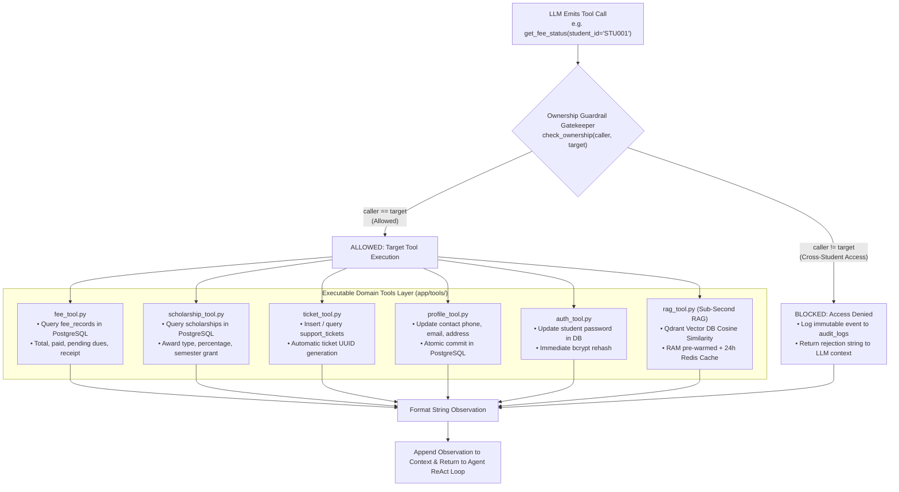

# 🛠️ Agent Tools Layer (`app/tools`)

The **Tools Layer** contains executable Python functions that the conversational agent calls dynamically when answering student inquiries. Every tool is instrumented with **ownership guardrails** to prevent unauthorized cross-student data leakage.

---

## 🏗️ Agent Tool Execution Lifecycle

---

## 📁 Module Inventory

| File | Tool Functions Exposed | Target Subsystem | Description |
|---|---|---|---|
| [`fee_tool.py`](./fee_tool.py) | `get_fee_status` | PostgreSQL (`fee_records`) | Retrieves tuition fees, amount paid, pending balance, and payment receipts. |
| [`scholarship_tool.py`](./scholarship_tool.py) | `check_scholarship` | PostgreSQL (`scholarships`) | Retrieves active scholarship grants, concession percentages, and semester values. |
| [`ticket_tool.py`](./ticket_tool.py) | `create_support_ticket`, `get_ticket_status`, `list_student_tickets` | PostgreSQL (`support_tickets`) | Creates official support/escalation tickets and looks up resolution statuses. |
| [`profile_tool.py`](./profile_tool.py) | `update_student_profile` | PostgreSQL (`students`) | Updates student contact details (phone, email, campus hostel address) directly. |
| [`auth_tool.py`](./auth_tool.py) | `update_student_password` | PostgreSQL (`auth_credentials`) | Allows students to change their portal login password immediately in the database. |
| [`rag_tool.py`](./rag_tool.py) | `search_student_handbook` | Qdrant Vector DB | Performs dense semantic vector search over student handbook policy chunks. |

---

## 🛡️ Security & Guardrail Guarantees

1. **Identity Binding**: Tools verify that the authenticated caller identity matches the record being accessed or updated.
2. **Immediate Persistence**: State changes (tickets, profile updates, password changes) commit immediately to PostgreSQL within an isolated database transaction.
3. **Structured String Observations**: Tools return natural, well-formatted string summaries that the LLM seamlessly incorporates into its conversational response.
