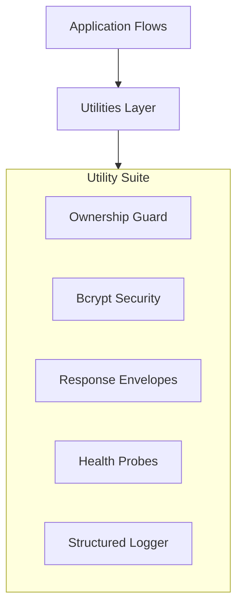

# 🛠️ Utilities & Cross-Cutting Concerns (`app/utils`)

The **Utils Layer** provides shared helper modules for ownership security enforcement, password cryptographic hashing, deep multi-dependency health probing, Loguru structured JSON logging, and uniform API response formatting.

---

## 🏗️ Cross-Cutting Utility Architecture

---

## 📁 Module Inventory

| File | Core Component | Role & Functionality |
|---|---|---|
| [`ownership.py`](./ownership.py) | `check_ownership` | Cross-tenant security guardrail: verifies caller owns the target `student_id` and logs violations to PostgreSQL `audit_logs`. |
| [`security.py`](./security.py) | `hash_password`, `verify_password` | Implements bcrypt password hashing with automatic salt generation and constant-time string verification. |
| [`response.py`](./response.py) | `success_response`, `error_response` | Helper functions producing uniform FastAPI JSON response envelopes (`status`, `message`, `data`/`errors`, `request_id`). |
| [`health.py`](./health.py) | `check_system_health` | Non-blocking async probe verifying live connectivity across PostgreSQL, Redis, and Qdrant. |
| [`logger.py`](./logger.py) | `logger` | Configures Loguru with rotating log files (`logs/application.log`), structured JSON output (`logs/application.json.log`), UTC timestamps, and colored console output. |

---

## 🔒 Security Implementation Details

- **Bcrypt Password Security**: Passwords are never stored in plaintext. Hashing utilizes bcrypt with standard work factor salting.
- **Constant-Time Verification**: `bcrypt.checkpw()` guards against timing attacks during password authentication.
- **Fail-Safe Ownership**: If a tool receives mismatched identities, `check_ownership` raises `AuthorizationError` (HTTP 403) and records a `BLOCKED` decision in PostgreSQL before any database row can be read.
- **Proactive Health Probing**: The `/health` endpoint detects database, cache, or vector store degradation asynchronously before impacting user turns.
