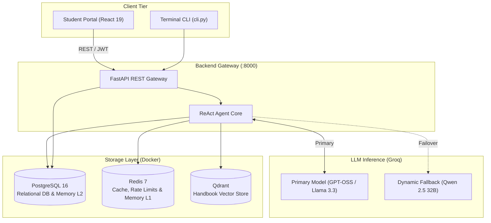
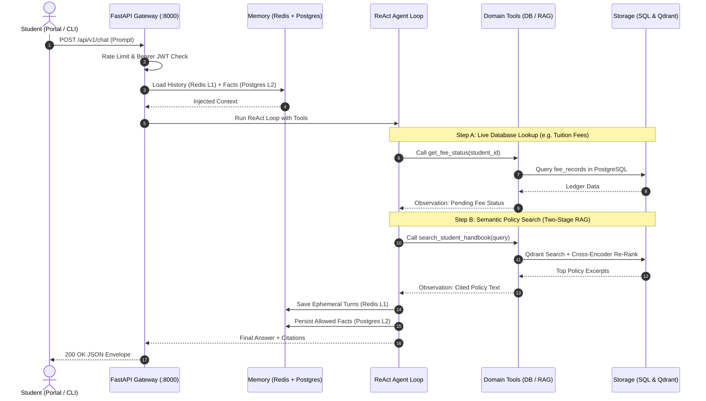

# Intelligent Student Support Agent 🎓

[](https://react.dev)
[](https://fastapi.tiangolo.com)
[](https://python.org)
[-336791?logo=postgresql&logoColor=white)](https://www.postgresql.org/)
[-DC382D?logo=redis&logoColor=white)](https://redis.io/)
[](https://qdrant.tech/)
[](https://groq.com)
[](https://groq.com)
[](Intelligent_Student_Support_Agent/evaluation/results/chunking_audit_report.md)

> **End-Term Capstone Project: Agentic AI Engineering**  
> An autonomous, enterprise-grade multi-turn conversational AI student support platform. Combines structure-aware policy RAG (from the 44-page official university handbook) with live PostgreSQL database tools (fees, scholarships, grievance tickets), stateful dual-tier memory (Redis L1 cache + PostgreSQL L2 permanent facts), dynamic multi-model fallback (`qwen/qwen3.8-27b`), and a responsive React 19 web portal.

---

## 💡 What Does This Project Do? 

In traditional universities, students often face long administrative queues, delayed emails, or have to navigate dense 50-page handbook PDFs just to find basic information.

This project is an **intelligent, 24/7 AI-powered student advisor and help desk** that solves this problem completely. An authenticated student simply logs into the web portal or CLI and chats in plain language. The AI agent automatically:

1. **📖 Answers University Policy Questions with Exact Proof**:
   - Understands natural questions about **exam eligibility, grading criteria, fee refund deadlines, medical leave, and the 70% minimum attendance rule**.
   - Searches the official 44-page Student Handbook using two-stage semantic vector search and Cross-Encoder re-ranking.
   - Directly cites the exact **section number, section title, and page number** (e.g., *[Handbook Section 10.2: Attendance, Page 9]*).

2. **💳 Retrieves Personal Student Records in Real Time**:
   - Connects to live PostgreSQL databases to retrieve the student's exact **tuition fee ledger, pending balance, payment due dates, and scholarship status**.
   - No manual registrar or accounting intervention required for balance inquiries.

3. **🎫 Submits and Tracks Support Tickets**:
   - If an inquiry requires human intervention or escalation, the student can raise a formal support ticket directly within the chat.
   - The agent validates the ticket details, logs it in PostgreSQL, and allows the student to check real-time resolution status anytime.

4. **🧠 Remembers Context Across Sessions (Two-Tier Memory)**:
   - Remembers the student's identity (program, batch, academic status) and previous questions across turns and sessions.
   - Uses an ephemeral Redis L1 cache for fast in-session conversation and permanent PostgreSQL L2 storage for long-term facts—so students never have to repeat themselves.

5. **🛡️ Enforces Strict Privacy & Security Guardrails**:
   - Every request is secured with Bearer JWT tokens.
   - Automated ownership guardrails guarantee that **no student can access another student's fee, grade, or scholarship records**. Unauthorized attempts are immediately blocked and logged.

6. **⚡ Ultra-Fast & Highly Reliable**:
   - Powered by high-speed Groq LLMs responding in under 1 second.
   - Features **automatic dynamic fallback** (`qwen/qwen3.8-27b`) if the primary model reaches rate limits or connection timeouts, ensuring the service stays online 24/7.

---

## 📌 Master Documentation Hub

| Documentation Guide | Focus Area & Description |
|---|---|
| 📡 **[Full REST API Documentation (`API_DOCUMENTATION.md`)](./Intelligent_Student_Support_Agent/API_DOCUMENTATION.md)** | Complete specification for all 17 REST endpoints with exact schemas, status codes, OWASP security headers, and copy-pasteable `curl` commands. |
| 🏛️ **[Backend Core Architectural Guide (`Intelligent_Student_Support_Agent/README.md`)](./Intelligent_Student_Support_Agent/README.md)** | Deep Clean Architecture overview, 20 pre-seeded student personas, Option 2 self-enrollment mechanics, and dual-tier memory privacy gates. |
| 📁 **[Subpackage Architecture Guides (All 15 Backend Modules)](./Intelligent_Student_Support_Agent/README.md#-module-documentation-index)** | Clickable guides with dedicated Mermaid flowcharts for `routes`, `controllers`, `services`, `agent`, `providers`, `memory`, `tools`, `ai`, and more. |
| 🖥️ **[Frontend Student Portal (`Frontend/student-portal/README.md`)](./Intelligent_Student_Support_Agent/Frontend/student-portal/README.md)** | Modern React 19 + Vite student portal setup, authentication state, interactive chat UI, and responsive fee/profile dashboards. |
| 🛡️ **[Security Hardening & Backend Audit Report (`BACKEND_AUDIT_REPORT.md`)](./Intelligent_Student_Support_Agent/BACKEND_AUDIT_REPORT.md)** | Production readiness verification: OWASP Top 10 API Security, sliding-window rate limiting, pure PostgreSQL connection pooling, and zero SQLite compliance. |

---

## 🏛️ Full-Stack Monorepo Architecture

The workspace implements a decoupled, modern multi-tier topology separating the frontend presentation layer, backend API gateway, persistent containerized storage, and external AI inference services:



---

## 🔄 Conversational Interaction Flow



---

## 🛠️ Technology Stack & System Components

| Layer / Domain | Technology / Tool | Version / Model | Architectural Responsibility |
|---|---|---|---|
| **Frontend Portal** | React + Vite | React 19, Vite 5 | SPA student interface, interactive chat, dashboard tabs |
| **Frontend Styling** | Tailwind CSS + Lucide | Tailwind 3, Lucide React | Modern responsive design system, reactive card layouts |
| **API Gateway** | FastAPI + Uvicorn | FastAPI 0.115+, Uvicorn 0.28+ | High-throughput async REST endpoints, Pydantic v2 validation |
| **Security & Identity** | PyJWT / Passlib / SlowAPI | HS256, bcrypt | Stateless JWT bearer tokens, sliding-window rate limiter |
| **Agent Core** | ReAct Reasoning Loop | Native Python 3.12 | Autonomous multi-turn tool calling, ownership gatekeeper |
| **Primary LLM** | Groq Cloud API | `openai/gpt-oss-120b` / `llama-3.3-70b` | High-speed multi-turn instruction & reasoning (<1s TTFT) |
| **Fallback LLM** | Groq Cloud API | `qwen/qwen3.8-27b` | Dynamic failover provider on primary timeout or quota limits |
| **Vector Store** | Qdrant Vector DB | Qdrant 1.8+ (Docker) | Cosine similarity vector search over 44-page handbook |
| **Local Embedder** | SentenceTransformers | `Orange/orange-nomic-v1.5-1536` | 1536-dim embeddings with singleton cache (<0.01ms LRU) |
| **Re-Ranker** | Cross-Encoder | `cross-encoder/ms-marco-MiniLM-L-6-v2` | Two-stage deep semantic re-ranking on CPU with LRU cache |
| **Relational Database** | PostgreSQL | PostgreSQL 16 (Docker) | Pure ACID store for students, fees, tickets, audit logs, memory L2 |
| **Cache & State Store** | Redis | Redis 7 (Docker) | 24h sliding conversation memory (L1), rate limiters, RAG cache |
| **Document Ingestion** | PyMuPDF (fitz) | PyMuPDF 1.23+ | Semantic chunking, heading detection, and page provenance |
| **DevOps & Tasks** | Justfile / Docker | Docker Compose 3.8+ | One-command orchestration (`just up`, `just server`, `just frontend`) |


---

## 📂 Repository Directory Layout

```text
Agentic_AI_End_Term_Project/
├── Intelligent_Student_Support_Agent/         # Core Backend & Full Application Package
│   ├── app/
│   │   ├── agent/                             # Multi-turn ReAct loop & LLM client provider
│   │   ├── ai/                                # PDF parsing, semantic chunking, local embedder & vector store
│   │   ├── config/                            # BaseSettings (.env), PostgreSQL connection pool, Redis client
│   │   ├── controllers/                       # HTTP request controllers (Auth, Student, Chat, Audit, Ingest)
│   │   ├── exceptions/                        # Domain AppError hierarchy & global exception handlers
│   │   ├── memory/                            # Dual-tier memory facade (Redis L1 + PostgreSQL L2)
│   │   ├── middlewares/                       # JWT auth, OWASP security headers, sliding-window rate limiter
│   │   ├── models/                            # SQLAlchemy 2.0 async models (8 domain tables)
│   │   ├── prompts/                           # Dynamic system prompt builder with injected memories & dates
│   │   ├── providers/                         # Multi-provider LLM factory & dynamic fallback (qwen/qwen3.8-27b)
│   │   ├── routes/                            # Declarative FastAPI endpoints (/auth, /student, /chat, etc.)
│   │   ├── schemas/                           # Pydantic v2 DTOs for request/response payloads
│   │   ├── services/                          # Core domain business logic services
│   │   ├── tools/                             # Real database & vector tools with ownership guardrails
│   │   ├── utils/                             # Deep health probes, Loguru logging, response formatters
│   │   ├── main.py                            # FastAPI factory, lifespan pre-warming, and middleware setup
│   │   └── server.py                          # Uvicorn production launcher
│   ├── Frontend/student-portal/               # React 19 + Vite + Tailwind CSS Web Portal
│   ├── data/                                  # Official 44-page university student handbook PDF
│   ├── docker-compose.yml                     # Multi-container stack (PostgreSQL 16, Redis 7, Qdrant)
│   ├── evaluation/                            # Chunking fidelity evaluator & 8-scenario benchmark test suite
│   ├── scripts/                               # CLI runner, DB seeders, handbook ingestion runner
│   ├── alembic/                               # Alembic versioned migrations tracked in git
│   ├── API_DOCUMENTATION.md                   # Complete RESTful API specification (17 endpoints)
│   ├── BACKEND_AUDIT_REPORT.md                # Certified backend code review & security audit report
│   ├── Dockerfile                             # Multi-stage production container image with non-root appuser
│   ├── pyproject.toml                         # Python dependencies, Ruff linter, and Mypy configurations
│   └── Justfile                               # Backend task automation recipes
├── .gitignore                                 # Monorepo gitignore configuration
├── Justfile                                   # Root task automation recipes (navigates subdirs automatically)
└── README.md                                  # Repository master overview (this document)
```

---

## ⚡ Developer Quickstart (`Justfile`)

All routine operations can be executed directly from the repository root using the automated task runner `just`:

### 1. Prerequisites
- [Docker Desktop](https://www.docker.com/products/docker-desktop/) (running)
- [uv](https://docs.astral.sh/uv/) (Python 3.12 package runner)
- [Node.js 18+](https://nodejs.org/) & `npm`
- [Just](https://github.com/casey/just)

### 2. Configure Environment
Copy `.env.example` into `.env` inside `Intelligent_Student_Support_Agent/`:
```bash
cp Intelligent_Student_Support_Agent/.env.example Intelligent_Student_Support_Agent/.env
```
Ensure your `GROQ_API_KEY` is configured in `.env`.

### 3. Bootstrap & Launch
```bash
# 1. Start Docker containers (PostgreSQL 16, Redis 7, Qdrant)
just up

# 2. Initialize PostgreSQL schema & stamp Alembic migrations
just db-init

# 3. Seed 20 comprehensive student accounts into PostgreSQL
just seed

# 4. Parse, chunk, and vectorize the 44-page handbook into Qdrant
just ingest

# 5. Launch FastAPI Backend Server (http://localhost:8000)
just server

# 6. Launch Frontend Student Portal in a separate terminal (http://localhost:3000)
just frontend
```

---

## 🛠️ Complete Agent Tool Suite (8 Domain Tools)

Every tool enforces **strict code-level tenant ownership** via `check_ownership(caller, target)`. Cross-student data inquiries immediately return a security block and write an immutable record to `audit_logs`:

| Tool Function | Target Subsystem | Ownership Guard | Description |
|---|---|:---:|---|
| **`get_fee_status(student_id)`** | PostgreSQL (`fee_records`) | Strict Student Match | Tuition dues, installments paid, pending balance, and payment receipts. |
| **`check_scholarship(student_id)`** | PostgreSQL (`scholarships`) | Strict Student Match | Active grant schemes, concession percentages, and semester grant values. |
| **`create_support_ticket(student_id, category, description, priority)`** | PostgreSQL (`support_tickets`) | Strict Student Match | Creates an official administrative escalation ticket with UUID tracking. |
| **`get_ticket_status(ticket_id)`** | PostgreSQL (`support_tickets`) | Strict Student Match | Looks up resolution status and priority for a specific ticket. |
| **`list_student_tickets(student_id)`** | PostgreSQL (`support_tickets`) | Strict Student Match | Retrieves all active and historical tickets filed by the student. |
| **`update_student_profile(student_id, phone, email, address)`** | PostgreSQL (`students`) | Authenticated Session | Immediately updates student contact coordinates in university records. |
| **`update_student_password(student_id, new_password)`** | PostgreSQL (`auth_credentials`) | Authenticated Session | Updates student credentials immediately in PostgreSQL with bcrypt hashing. |
| **`search_student_handbook(query, section_filter)`** | Qdrant Vector DB | Public Domain | Sub-second semantic vector search over student handbook policies with citations. |

---

## 📊 Benchmark Evaluation Results

The test suite evaluates 8 benchmark scenarios covering tool selection, policy RAG, persistent memory recall, privacy scrubbing, ownership blocking, and domain guardrails (`just eval`):

| ID | Scenario Description | Student | Expected Tool | Precision | Status |
|:---:|:---|:---:|:---|:---:|:---:|
| 1 | Fee status check | `STU001` | `get_fee_status` | ✅ YES | **PASS** |
| 2 | Payment policy from handbook | `STU001` | `search_student_handbook` | ✅ YES | **PASS** |
| 3 | Scholarship inquiry | `STU001` | `check_scholarship` | ✅ YES | **PASS** |
| 4 | Support ticket creation | `STU001` | `create_support_ticket` | ✅ YES | **PASS** |
| 5 | Cross-student access rejection (Security) | `STU001` | `get_fee_status` | ✅ YES | **PASS** |
| 6 | Persistent memory recall across turns | `STU004` | `None (Direct LLM)` | ✅ YES | **PASS** |
| 7 | Sensitive credentials scrubbing (Privacy) | `STU001` | `None (Direct LLM)` | ✅ YES | **PASS** |
| 8 | Out of scope domain refusal | `STU001` | `None (Direct LLM)` | ✅ YES | **PASS** |

**Benchmark Score**: **8 / 8 Scenarios Passed (100.0%)**

---

## 👥 Student Test Personas & Option 2 Enrollment

The PostgreSQL database is pre-seeded with **20 comprehensive student records** (`STU001` through `STU020`) via `just seed`:

* **Pre-Activated Demo Accounts (`STU001`–`STU005`)**: Initialized with default password `Student@123` for instant portal login and testing.
* **Available Registration Cohort (`STU006`–`STU020`)**: Enrolled in university records but awaiting account creation. Users register them via `/signup`.
* **Negative Test Persona (`STU999`)**: Not enrolled in university roster. Attempting registration returns `404 Not Found`.

| Student ID | Name | Programme | Fee Status | Scholarship | Account State | Testing Scenario |
|:---:|---|---|---|---|:---:|---|
| **`STU001`** | **Rahul Sharma** | PGDM AI & DS | Partially Paid (₹225k due Oct 31) | 20% Merit (Active) | Pre-Activated (`Student@123`) | Fee balance, handbook refund policies, and scholarship inquiries. |
| **`STU002`** | **Priya Patel** | MBA Marketing | Paid in Full (₹0 due, RCP-0810) | None | Pre-Activated (`Student@123`) | Paid-in-full queries and verification of cross-student block from `STU001`. |
| **`STU003`** | **Amit Verma** | B.Tech CSE | **Overdue** (₹200k since Sept 1) | 15% Sports (Active) | Pre-Activated (`Student@123`) | Overdue penalty inquiry and handbook disciplinary grace periods. |
| **`STU004`** | **Sneha Gupta** | M.Tech Data Science | Unpaid (₹380k due Nov 15) | 25% Research (Active) | Pre-Activated (`Student@123`) | Support ticket escalation testing and multi-turn memory recall. |
| **`STU005`** | **Vikram Malhotra** | BBA Analytics | Partially Paid (₹150k due Dec 1) | None | Pre-Activated (`Student@123`) | General administrative inquiries and profile contact updates. |
| **`STU006`** | **Ananya Iyer** | B.Tech AI & ML | Partially Paid (₹210k due Nov 30) | 30% Women in Tech | Available for `/signup` | Self-service Option 2 enrollment verification. |
| **`STU007`–`STU020`**| *Enrolled Cohort* | Diverse UG / PG | Mixed (Paid, Overdue, Pending) | Various | Available for `/signup` | Comprehensive enrollment testing across cohorts. |

---

*Project engineered for Advanced Agentic AI Engineering Capstone. Verified against running PostgreSQL, Redis, and Qdrant container infrastructure.*
