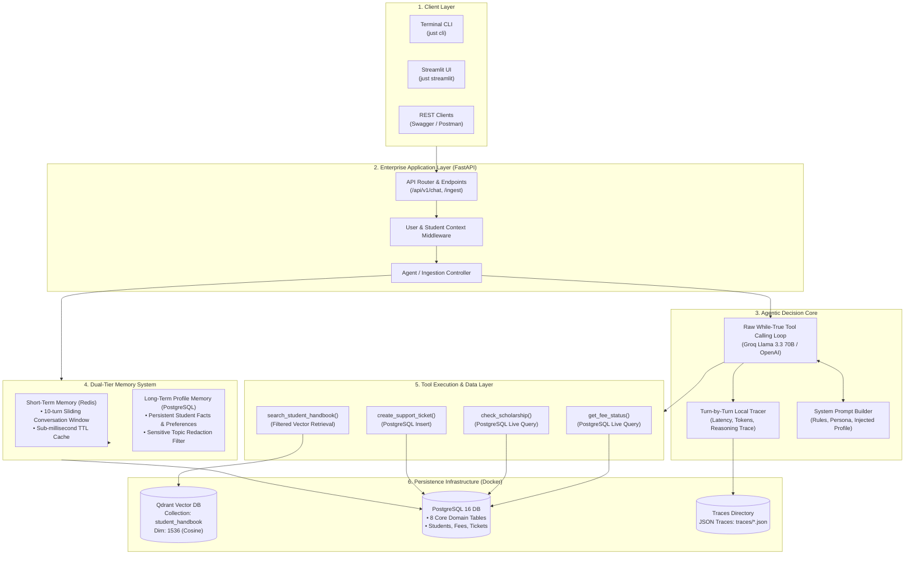
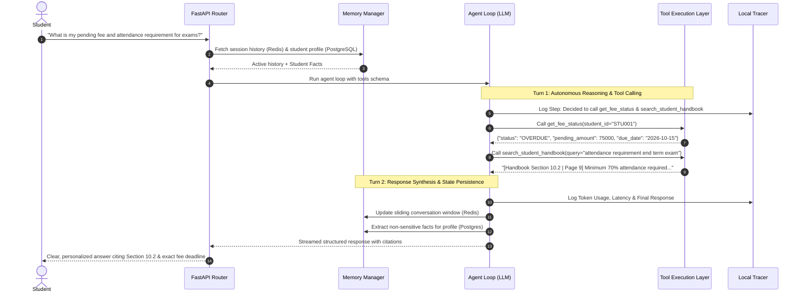
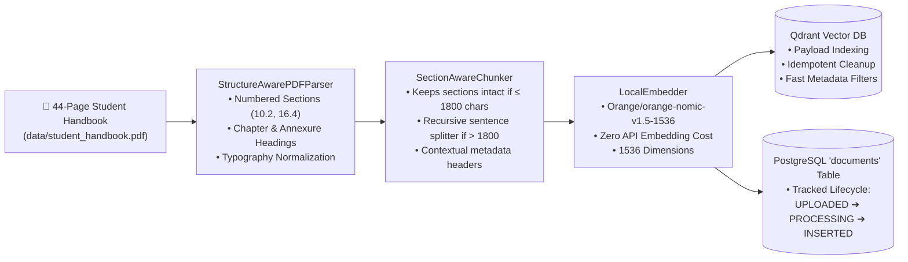

# Intelligent Student Support Agent 🎓

[](https://python.org)
[](https://fastapi.tiangolo.com)
[](https://www.postgresql.org/)
[](https://qdrant.tech/)
[](https://redis.io/)
[](https://groq.com)
[](Intelligent_Student_Support_Agent/evaluation/results/chunking_audit_report.md)

> **End-Term Capstone Project: Agentic AI Engineering**  
> An autonomous, enterprise-grade multi-turn conversational AI student support system. Combines structure-aware policy RAG (from the 44-page official student handbook) with real-world PostgreSQL database tools (fees, scholarships, support tickets), stateful dual-tier memory (Redis + Postgres), and turn-by-turn observability.

---

## 📌 Table of Contents
1. [System Architecture](#-system-architecture)
2. [Data Flow & Agent Loop](#-data-flow--agent-loop)
3. [Document Ingestion & RAG Pipeline](#-document-ingestion--rag-pipeline)
4. [Chunking Fidelity & Evaluation Dashboard](#-chunking-fidelity--evaluation-dashboard)
5. [Database Schema & Mock Data](#-database-schema--mock-data)
6. [Repository Structure](#-repository-structure)
7. [Getting Started & Quickstart](#-getting-started--quickstart)
8. [Available Tool Suite](#-available-tool-suite)

---

## 🏛️ System Architecture

The project adheres to enterprise clean architecture (**Routes → Controllers → Services → Agent Loop → Data Layer**), keeping business logic decoupled from transport and storage layers.



---

## 🔄 Data Flow & Agent Loop

Every student interaction passes through an autonomous multi-turn reasoning and tool-calling cycle:



---

## 📚 Document Ingestion & RAG Pipeline

Instead of naive fixed-character splitting that breaks policies across arbitrary sentences, we implement **Structure-Aware Chunking** tailored to academic policy handbooks:



---

## 📊 Chunking Fidelity & Evaluation Dashboard

We verify chunking and RAG quality through an automated **5-Dimension Fidelity Audit** ([evaluate_chunking.py](Intelligent_Student_Support_Agent/evaluation/evaluate_chunking.py)) benchmarked directly against the ground-truth 44-page student handbook:

| Metric Dimension | Fidelity Score | Benchmark Target | Status | Verification Detail |
|---|---|---|---|---|
| **Text Coverage** | **100.0%** | > 85.0% | ✅ **PASS** | 1,840 of 1,840 unique handbook vocabulary tokens preserved |
| **Metadata Accuracy** | **100.0%** | > 90.0% | ✅ **PASS** | 64 of 64 chunks matched ground-truth page & section provenance |
| **Boundary Quality** | **95.31%** | > 85.0% | ✅ **PASS** | 61 of 64 chunks retain cohesive, unbroken policy rules & exceptions |
| **Text Integrity** | **100.0%** | > 90.0% | ✅ **PASS** | 64 of 64 chunks verified free of unicode artifacts or broken glyphs |
| **Table Integrity** | **100.0%** | > 85.0% | ✅ **PASS** | 48 of 48 tabular chunks maintain grade point alignments & curriculum columns |

👉 **[Read the Full Executive Chunking Audit Report](Intelligent_Student_Support_Agent/evaluation/results/chunking_audit_report.md)**

---

## 🗄️ Database Schema & Mock Data

All relational student data is stored and queried directly in **PostgreSQL 16** (not flat JSON mock files).

| Table Name | Primary Purpose | Key Fields |
|---|---|---|
| `students` | Core student profile & enrollment | `id`, `student_id`, `name`, `email`, `programme`, `batch`, `cgpa` |
| `fee_records` | Fee installments & financial status | `id`, `student_id`, `term`, `amount_due`, `due_date`, `status` |
| `scholarships` | Merit & need-based scholarship registry | `id`, `student_id`, `scheme_name`, `amount_granted`, `is_active` |
| `support_tickets`| Student grievances & requests | `id`, `ticket_number`, `student_id`, `category`, `description`, `status` |
| `conversations` | Conversation sessions tracking | `id`, `student_id`, `created_at`, `status` |
| `messages` | Turn-by-turn conversation messages | `id`, `conversation_id`, `sender`, `content`, `tokens` |
| `student_memories`| Long-term extracted facts & preferences | `id`, `student_id`, `fact_key`, `fact_value`, `category` |
| `documents` | Ingested PDF document lifecycle | `id`, `filename`, `file_hash`, `total_chunks`, `status` |

---

## 📂 Repository Structure

```text
Agentic_AI_End_Term_Project/
├── Intelligent_Student_Support_Agent/
│   ├── app/
│   │   ├── agent/                 # Agent loop, Groq/OpenAI client, tool dispatcher
│   │   ├── ai/
│   │   │   ├── ingestion/         # PDF parser, dynamic chunker, local embedder
│   │   │   └── retrieval/         # Qdrant vector store client & metadata filters
│   │   ├── config/                # Pydantic BaseSettings, PostgreSQL & Redis setups
│   │   ├── controllers/           # HTTP Request Controllers
│   │   ├── exceptions/            # Custom AppError hierarchy & global handlers
│   │   ├── memory/                # Dual-tier Redis + PostgreSQL memory managers
│   │   ├── middlewares/           # Context & authentication middlewares
│   │   ├── models/                # SQLAlchemy models (8 domain tables)
│   │   ├── prompts/               # System prompt templates & guardrails
│   │   ├── routes/                # FastAPI endpoint routers
│   │   ├── schemas/               # Pydantic DTOs & OpenAI tool schemas
│   │   ├── services/              # IngestionService & AgentService
│   │   ├── tools/                 # Real database tools (fee, scholarship, tickets, RAG)
│   │   ├── utils/                 # Loguru logger, API response formatters
│   │   ├── main.py                # FastAPI app initialization & CLI entrypoint
│   │   └── server.py              # Uvicorn server launcher
│   ├── data/                      # PDF Handbook and mock database records
│   ├── docker-compose.yml         # Container definitions (PostgreSQL, Redis, Qdrant)
│   ├── evaluation/
│   │   ├── evaluate_chunking.py   # 5-dimension chunking fidelity auditor
│   │   └── results/               # Markdown audit reports & evaluation hub index
│   ├── scripts/                   # DB init, seeder, handbook ingestion, evaluation
│   ├── traces/                    # Local turn-by-turn tracer logs (traces/*.json)
│   ├── tracing/                   # LocalTurnTracer implementation
│   ├── pyproject.toml             # Project dependencies & package discovery
│   └── Justfile                   # Task runner automation recipes
├── .gitignore                     # Git configuration (tracks reports & traces)
├── Justfile                       # Workspace top-level task runner
└── README.md                      # Repository root documentation (this file)
```

---

## ⚡ Getting Started & Quickstart

### 1. Prerequisites
- [Docker Desktop](https://www.docker.com/products/docker-desktop/) (running)
- [uv](https://docs.astral.sh/uv/) (blazing-fast Python package manager)
- [Just](https://github.com/casey/just) (command runner)

### 2. Environment Configuration
Copy `.env.example` to `.env` inside `Intelligent_Student_Support_Agent/`:
```bash
cp Intelligent_Student_Support_Agent/.env.example Intelligent_Student_Support_Agent/.env
```
Ensure your `GROQ_API_KEY` or `OPENAI_API_KEY` is specified in `.env`.

### 3. One-Command Setup
Execute the following automated `just` commands:

```bash
# 1. Start Docker containers (PostgreSQL 16, Redis 7, Qdrant)
just up

# 2. Initialize PostgreSQL tables (creates all 8 domain tables)
just db-init

# 3. Seed mock student data into PostgreSQL
just seed

# 4. Ingest and embed the 44-page student handbook into Qdrant
just ingest

# 5. Run the chunking fidelity audit (validates 100% scores)
just audit-chunks
```

### 4. Running the Application

```bash
# Launch FastAPI Backend Server (http://localhost:8000)
just server

# Launch Interactive Streamlit UI
just streamlit

# Launch Terminal CLI Interface
just cli
```

---

## 🛠️ Available Tool Suite

The agent has access to 4 purpose-built tools:

1. **`search_student_handbook(query, section_filter)`**:
   - Queries the local Qdrant collection with 1536-dimensional semantic similarity.
   - Returns citation headers (`[Handbook Section 10.2 | Page 9]`) with exact rule text.
2. **`get_fee_status(student_id)`**:
   - Asynchronously queries the PostgreSQL `fee_records` table.
   - Returns fee installment details, due dates, penalty rules, and overdue balances.
3. **`check_scholarship(student_id)`**:
   - Queries the PostgreSQL `scholarships` table.
   - Returns active scholarship awards, grant amounts, and renewal criteria.
4. **`create_support_ticket(student_id, category, description, priority)`**:
   - Generates a unique tracking ticket (e.g. `TICK-8472`) and inserts it into `support_tickets`.
